# ADD-0001: orange First Version (V1) Architecture Baseline

## Metadata [Required]

- **Design Status**: Current
- **Date**: 2026-10-12
- **Author**: @zcode
- **Architecture Owner**: @hailingu
- **Required Approver**: @hailingu
- **Approver [Conditionally Required — Design Status is or has been `Current`]**: @hailingu
- **Approval Time [Conditionally Required — Design Status is or has been `Current`]**: 2026-10-13T09:23:35Z
- **Approval Evidence [Conditionally Required — Design Status is or has been `Current`]**: Approve
- **Approval Context Revision [Optional — informational and non-binding]**: 35406302b574502eebf7a17a1fd8efb402b82e4e — immutable revision whose document content equals the content present for approval; the approval edits were made after approval within the same change
- **Retired By [Conditionally Required — Design Status is `Deprecated` or `Superseded`]**: N/A — not retired
- **Retirement Time [Conditionally Required — Design Status is `Deprecated` or `Superseded`]**: N/A — not retired
- **Retirement Evidence [Conditionally Required — Design Status is `Deprecated` or `Superseded`]**: N/A — not retired
- **Retirement Reason [Conditionally Required — Design Status is `Deprecated` or `Superseded`]**: N/A — not retired
- **Scope Level**: Repository / Cross-project
- **Scope**: Locally deployed orange V1 — C++20 compute service, TypeScript web client, and repository-versioned mathematics content (advanced mathematics, mathematical analysis, matrix computation)
- **Demand Sources**: AGENTS.md project statement; user task requests and owner feedback 2026-10-12
- **Figma Sources [Conditionally Required — UI is in scope]**: N/A — no UI design source exists for V1; presentation design is owned by the selected implementation ADRs
- **Related [Optional]**: docs/adr/ADR-0001-orange-issue-governance.md (governance records); docs/adr/ADR-0002-governance-validator-adoption.md (validator adoption and this document's template alignment)
- **Supersedes [Conditionally Required — this ADD replaces another]**: None
- **Superseded By [Conditionally Required — this ADD is replaced]**: None — not superseded

## Requirement Level Legend [Required]

- **`[Required]`**: The section or field always applies and MUST remain present
  with complete, verifiable content. Use `None — <reason>` only when the
  template explicitly permits an empty result; never leave it blank.
- **`[Conditionally Required — <trigger>]`**: The section or field MUST be
  completed when its stated trigger applies. When the trigger does not apply,
  retain `N/A — <reason>` unless the template explicitly instructs removal or
  retention as inactive future-lifecycle guidance. A missing trigger assessment
  is incomplete content.
- **`[Optional]`**: The section may be removed without affecting acceptance,
  execution, completion, or verification. If retained, it MUST be accurate and
  complete; optional content MUST NOT substitute for required evidence.

Unlabeled fields inside a `[Required]` section are required.

## Context And Solution Summary [Required]

orange is a Web system for studying advanced mathematics, mathematical
analysis, and matrix computation (physics and chemistry are later scope); it
renders function graphs and provides dynamic interaction, with a backend in
C++20 and a frontend in TypeScript. Developing orange is itself part of the
learning goal: the project doubles as a hands-on study of the C++ and Web
technologies it is built with. The first version (V1) is the first locally
usable increment: a single student can run it and study with it on one
machine, with no accounts, no multi-user capability, and no server-side
persistence. The study loop covers content reading, parameterized practice,
self-testing, and deterministic mastery assessment driven by an append-only
local answer history; an optional, learner-configured AI tutor supplements —
but never replaces — authored explanations.

This ADD is a non-authorizing solution and planning view. It authorizes no
source, configuration, build, deployment, or operational change. Implementation
requires an Accepted ADR selected from one task candidate in ADR Task
Candidates under the ADD-To-ADR handoff contract of `AGENTS.md`.

**Solution summary**: a TypeScript web client (navigation, graph workspace,
matrix playground, practice and self-test views, progress store, optional AI
tutor client) served locally beside a loopback-only C++20 compute service
(expression evaluation, matrix computation, exercise synthesis and grading),
all content — topics, learning-path graphs, parameterized exercise templates,
static assets — repository-versioned and validated by an authoring-time
content validator outside the runtime.

**Design boundary**: this document covers capabilities, conceptual data,
architecture, flows, constraints, traceability, and ADR task candidates only.
Exact schemas, serialization, file plans, commands, test implementations, and
other task-level mechanics belong to the ADR selected for each candidate.

## Requirement Baseline [Required]

| ID | Demand source | Requirement baseline | Acceptance outcome | Priority and constraints | Last checked |
| --- | --- | --- | --- | --- | --- |
| D-01 | AGENTS.md project statement | orange is a Web system for studying advanced mathematics, mathematical analysis, matrix computation, physics, and chemistry. | Subject study navigation and content for the mathematics areas is observable locally (CAP-01); physics and chemistry are later scope under D-16 | Mathematics first; broader subjects later | 2026-10-12 |
| D-02 | AGENTS.md project statement | orange renders function graphs and provides dynamic interaction with them. | Graph rendering and pan/zoom/reset/edit interaction with live re-rendering (CAP-02, CAP-03) | Core capability | 2026-10-12 |
| D-03 | AGENTS.md project statement | The backend is implemented in C++20 and the frontend in TypeScript; developing orange is itself a hands-on study of the C++ and Web technologies it is built with, so the technology boundary is part of the demand, not a free implementation choice. | All components respect the fixed technology boundary (CON-01) | Fixed; not an implementation choice | 2026-10-12 |
| D-04 | User task request 2026-10-12 | The first version (V1) is the first locally usable increment of the above demand: a single student can run it and study with it on one machine. | One documented local runtime path starts both sides with no external services (CAP-06) | Local-only deployment (D-15) | 2026-10-12 |
| D-05 | Repository owner feedback 2026-10-12 | Within each subject area, knowledge is arranged in an explicit learning order managed as a directed learning-path graph and presented to the student as a flowchart knowledge map; the order is advisory and never gatekeeping. | Flowchart knowledge maps derived from validated directed graphs; advisory order never blocks access (CAP-01, INV-07, INV-08) | Advisory, deterministic validation | 2026-10-12 |
| D-06 | Repository owner feedback 2026-10-12 | orange is a personal knowledge-learning tool for one learner on one machine: the product has no user accounts, no authentication or authorization, and no multi-user capability — a permanent product boundary, not a V1 deferral. | No accounts, authentication, authorization, or multi-user capability anywhere in the product (NG-01, INV-04) | Permanent product boundary | 2026-10-12 |
| D-07 | Repository owner feedback 2026-10-12 | The study loop includes practice and assessment: topics carry exercises, the student can self-test, and every answer is recorded incrementally — one question answered, one record written — into a cross-session client-side answer history that drives mastery assessment. | Incremental durable answer recording, six-question self-tests, and deterministic mastery derivation (CAP-07 through CAP-09, INV-09) | One committed record before acknowledged feedback | 2026-10-12 |
| D-08 | Repository owner feedback 2026-10-12 | The question bank is the sole runtime content source for exercises, authored in the repository development workflow: AI drafts templates at authoring time, outside the runtime boundary; review is tiered so the single learner is never exposed to content answers before practice — deterministic machine validation is the binding correctness gate, AI review is advisory for quality and coverage, and human review is limited to structural metadata without content-deep reading. | Validated bank revisions are the only runtime exercise source; eligibility validation blocks unvalidated content (INV-17, CF-08) | Repository authoring only; no runtime generation | 2026-10-12 |
| D-09 | Repository owner feedback 2026-10-12 | Practice must resist answer memorization: exercises are authored as parameterized templates, and every attempt presents a freshly drawn instance (new parameter values, reshuffled choice options), so assessment measures mastery of the method rather than recall of specific answers. | Fresh parameterized instances per attempt with bounded freshness redrawing (PR-05, PR-06) | Anti-memorization is a product rule | 2026-10-12 |
| D-10 | Repository owner feedback 2026-10-12 | Learning progress management covers two dimensions at knowledge-point granularity: what the student has read (content study) and what has been assessed as mastered (exercise performance), both visible on the knowledge map and topic pages, together with per-knowledge-point exercise coverage. | Separate read, mastery, and coverage dimensions visible on maps and topic pages (CAP-09, CAP-10) | Two dimensions never imply each other | 2026-10-12 |
| D-11 | Repository owner feedback 2026-10-12 | "Learned" is defined deterministically: a knowledge point is mastered when its last three attempts on freshly drawn instances are all correct; any wrong answer resets that point's streak; the state is always recomputable from the append-only answer history. | Fixed three-independent-correct mastery rule derived solely from ordered history (INV-12, PR-03) | Threshold fixed; no override | 2026-10-12 |
| D-12 | Repository owner feedback 2026-10-12 | Exercise coverage includes graphical understanding: choice exercises may carry function-expression options rendered as 2D mini-curves; 3D surface visualization is deferred beyond V1. | 2D graph-choice options render in practice and self-test (CAND-0010); 3D is NG-09 | 2D only in V1 | 2026-10-12 |
| D-13 | Repository owner feedback 2026-10-12 | Exercise stems, worked explanations, and study content may reference repository-versioned static image assets (geometric figures, physics diagrams, chemistry structures); images referenced by a parameterized template must be parameter-agnostic — they must not embed values that vary per instance. | Parameter-agnostic static assets with mechanically verifiable provenance (CON-10) | Parameter independence mechanically verified | 2026-10-12 |
| D-14 | Repository owner feedback 2026-10-12 | After grading, the student can tutor interactively with a runtime AI: free-form questions about the completed exercise and escalating hints before answering. The AI endpoint, model, and API key are configured locally by the learner and never enter the repository; when unconfigured or unavailable, tutoring degrades to the exercise's own authored answer and explanation, which remain mandatory bank content; grading and mastery never depend on AI. | Optional browser-only AI tutoring with mode-specific authored fallback; grading and mastery stay offline and deterministic (CAP-11, INV-14, INV-15) | AI is optional and never authoritative | 2026-10-12 |
| D-15 | Repository owner clarification 2026-10-12 | orange is deployed only on the learner's local machine; cloud or hosted deployment is outside the product deployment scope. An optional AI provider is not an orange deployment target. | Loopback-only compute service; no LAN or cloud mode (CON-02, NG-12) | Permanent deployment boundary | 2026-10-12 |
| D-16 | Repository owner clarification 2026-10-12 | Initial V1 content covers mathematics only: advanced mathematics, mathematical analysis, and matrix computation. Physics and chemistry remain later content scope. | Six mathematics topics and twelve knowledge points delivered (AO-04); physics/chemistry omitted from V1 navigation | Mathematics only in V1 | 2026-10-12 |
| D-17 | Repository owner instruction 2026-10-12 | Revise this Draft to close the reviewed gaps in progress attribution, durable recording, historical interpretation, instance freshness, content validation, tutoring disclosure, self-testing, asynchronous recovery, and task boundaries. | Gap-closure outcomes GO-01 through GO-10 are satisfied by linked implementation ADR evidence (AO-05) | Revision completed in the 2026-10-12 gap review | 2026-10-12 |

D-01 describes the longer-term subject scope; D-16 narrows the initial
release. The concrete Draft choices proposed under D-17 become the design
baseline only when this ADD is approved. D-11's three-answer threshold remains
fixed; the Data Model rules clarify which answers provide independent
assessment evidence.

### Acceptance-Outcome Baseline [Required]

V1 is complete when every statement below is demonstrably true on one
development machine:

- AO-01: Every capability outcome in Functional Capability Design (CAP-01
  through CAP-11) is observable in the locally running system by a single
  student.
- AO-02: Every task candidate in ADR Task Candidates (CAND-0001 through
  CAND-0018) is `Complete` via a linked ADR in `Complete` or `Verified` state.
  Deferring a required candidate does not complete V1; removing its outcome
  requires a deliberate revision and approval of this baseline.
- AO-03: No V1 component except the AI tutor requires an account or an
  external network service to deliver the capability outcomes, and no
  component requires a persistent server-side store; when the tutor's
  external service is unconfigured or unavailable, CAP-11 degrades to the
  authored explanation fallback with every other outcome intact.
- AO-04: All six mathematics topics and twelve knowledge points in Initial
  Mathematics Content Coverage are delivered with their specified reading and
  exercise coverage; physics and chemistry content is not required for V1
  acceptance.
- AO-05: The observable scenarios in Observable Gap-Closure Outcomes are
  satisfied by the linked implementation ADR evidence, including duplicate
  submissions, failed local writes, changed content, unavailable AI, and
  responses arriving out of order.

Baseline last checked: **2026-10-12**. Later demand changes do not silently
modify this ADD; drift must be reported and this document revised
deliberately, returning it to `Draft` if the change is
approval-invalidating.

## Goals And Non-Goals [Required]

Goals:

- G-01: Deliver the V1 acceptance-outcome baseline (Acceptance-Outcome
  Baseline above).
- G-02: Establish the durable system shape for later versions: web client,
  local compute service, repository-versioned content.
- G-03: Keep every slice small enough to be studied, reviewed, and learned
  from — each task candidate fits one independently reviewable implementation
  pull request.
- G-04: Close the study loop — learn, practice, self-test, and see mastery
  on the knowledge map.

Non-goals (all versions):

- NG-01: User accounts, authentication, authorization, and multi-user
  capability. orange is a personal study tool for one learner (D-06); these
  are excluded from the product itself, not deferred to a later version.
- NG-12: Cloud or hosted deployment of orange. The application and compute
  service run on the learner's machine (D-15); an optional tutoring provider
  does not host the orange application or its progress data.

Non-goals (V1):

- NG-02: Server-side persistence (databases, sessions surviving restart).
- NG-03: Container orchestration and remote deployment tooling.
- NG-04: Physics and chemistry content, exercises, and simulations; these
  subjects remain later scope under D-16.
- NG-05: Sharing or export features (collaboration is excluded product-wide
  by NG-01).
- NG-06: Internationalization and mobile-native applications.
- NG-07: Free-form symbolic-answer equivalence grading — V1 grades choice
  and numeric (tolerance) answers only.
- NG-08: Runtime AI question generation — exercise generation, grading,
  and mastery derivation stay offline and deterministic (D-08, D-09,
  INV-14); runtime AI is confined to tutoring dialogue (D-14).
- NG-09: 3D surface visualization (z = f(x, y) rendering with rotation
  interaction) — deferred to a future ADD; V1 renders 2D single-variable
  curves only.
- NG-10: In-product authoring or import UI — question-bank entry happens
  exclusively through the repository authoring workflow (D-08); an in-app
  authoring surface remains a possible future enhancement.
- NG-11: Parameterized figures that vary with instance parameters — V1
  static images are parameter-agnostic only (D-13).

## Functional Capability Design [Required]

| ID | Actor | Trigger | Capability and outcome | Business rules and edge cases | Requirements |
| --- | --- | --- | --- | --- | --- |
| CAP-01 | Student | Browse mathematics areas | Subject and topic study navigation: browse the three mathematics areas and six topics in Initial Mathematics Content Coverage; each area presents its knowledge map as a flowchart derived from the area's directed learning-path graph, with recommended next topics and legible notation and optional static figures | Every topic remains freely accessible regardless of order; physics and chemistry are omitted from V1 navigation rather than presented as usable empty subjects | D-01, D-05, D-16 |
| CAP-02 | Student | Enter a single-variable expression | Function graph rendering: see the curve rendered on a coordinate plane with axes and grid | Invalid or unsafe input produces a coded diagnostic (CAP-04), never a crash | D-02 |
| CAP-03 | Student | Pan, zoom, reset, or edit | Dynamic graph interaction: viewport operations and expression editing with live re-rendering of the curve | Superseded or cancelled responses never repaint; prior results stay labelled with their own expression and viewport | D-02 |
| CAP-04 | Graph workspace | Invalid or unsafe expression input | Expression validation and diagnostics: a precise, coded, human-readable diagnostic inside the workspace | The system never crashes or hangs from expression input | D-02 |
| CAP-05 | Student | Invoke a matrix operation | Matrix computation playground: define matrices and execute addition, subtraction, multiplication, transpose, determinant, and inverse | Dimension mismatch, non-finite values, and singularity produce distinct coded diagnostics | D-01 |
| CAP-06 | Developer | Build and start locally | Local single-user runtime: build and start the backend service and web client locally through one documented path, with no external services required | No LAN listener; ordinary restart preserves the browser origin | D-03, D-04, D-15 |
| CAP-07 | Student | Submit an exercise answer | Topic exercises: validated parameterized templates with typeset stems, optional parameter-independent figures, and worked explanations; a submission receives deterministic grading and a durable per-question record before completed feedback is acknowledged | V1 grades plain choice, 2D graph-choice, and numeric-tolerance answers; freshness and assisted-answer treatment follow the Data Model rules | D-07, D-09, D-12 |
| CAP-08 | Student | Start a topic self-test | Self-testing: a six-question topic self-test under Self-Test Rules, per-question feedback after durable recording, and a final score with per-question review | Abandoning or refreshing retains committed answers; the in-progress test itself is not resumed across reloads | D-07 |
| CAP-09 | System | Reduce committed answer history | Mastery assessment: ordered answer history deterministically derives independent three-correct-answer streaks per knowledge-point assessment revision, then explicit topic rollups | Incorrect answers reset the streak; assisted correct answers provide practice evidence without advancing it; mastery is visible and never gates navigation | D-10, D-11 |
| CAP-10 | Student | Explicitly confirm a study unit read | Reading progress: version-bound read events derive knowledge-point and topic read state across sessions; opening a page does not mark it read | Read, mastered, and exercise-coverage dimensions appear separately, with an unavailable state when persistence cannot be read reliably | D-10 |
| CAP-11 | Student | Ask for hints or post-answer help | AI tutoring with fallback: after completed grading, free-form questions grounded in that instance and its authored explanation; before answering, only ordered bank-owned method hints are displayed | AI may select an allowed next hint but arbitrary AI hint text is never displayed; when AI is absent, pre-answer guidance uses those hints and post-answer review uses the authored explanation; neither grading nor mastery depends on AI | D-14 |

### Initial Mathematics Content Coverage [Required]

Each listed topic has exactly the two assessable knowledge points named below
for the initial baseline. A complete topic includes notation and definitions,
the stated rule and its conditions, at least one worked example and one common
error per knowledge point, and at least one explicitly mapped study unit per
point. Each point has at least two parameterized templates, each permitting
at least three distinct valid problem instances and carrying a worked explanation
and at least two ordered method hints. Each point has at least five distinct
problem fingerprints across its templates, leaving three candidates after
excluding two recent assessment variants. The initial bank therefore contains
at least 24 templates. Choice and numeric kinds are both represented in each
area; the two marked graph topics each include at least one graph-choice
template. Graph-choice may count toward that topic's template minimum.

| Coverage ID | Mathematics area | Initial topic | Assessable knowledge points | Recommended order | Exercise emphasis |
| --- | --- | --- | --- | --- | --- |
| MC-01 | Advanced mathematics | Functions and elementary derivatives | Elementary derivative rules; chain rule | Before MC-02 | Choice and numeric derivative values |
| MC-02 | Advanced mathematics | Derivatives and function behavior | Monotonicity from derivative sign; stationary points and extrema | After MC-01; final node has no next recommendation | Numeric extrema and graph-choice behavior |
| MC-03 | Mathematical analysis | Sequence limits | Limits of elementary sequences; limit arithmetic and its conditions | Before MC-04 | Choice conditions and numeric limits |
| MC-04 | Mathematical analysis | Function limits and continuity | One-sided limits; continuity at a point | After MC-03; final node has no next recommendation | Numeric limits and graph-choice continuity |
| MC-05 | Matrix computation | Matrix operations | Dimension compatibility and entrywise operations; matrix multiplication and transpose | Before MC-06 | Choice dimensions and numeric entries |
| MC-06 | Matrix computation | Determinants and inverse matrices | Determinant and singularity; inverse existence and selected inverse entries | After MC-05; final node has no next recommendation | Choice invertibility and numeric determinant or inverse entries |

All twelve points have exercise coverage. Later or diagnostic content with no
validated templates shows `no exercise coverage`, has no mastery claim, and
cannot start a self-test. Coverage counts templates and available kinds, not
the number of times the learner has attempted them. These topics are an entry
baseline, not a claim to cover the full mathematics curriculum.

### Self-Test Rules [Required]

- ST-01: A test covers one current topic and its two knowledge points. It has
  six questions, three per point, interleaved in the topic's declared point
  order. Template selection rotates through the point's validated templates;
  a template may repeat with a distinct problem instance. The initial selection
  is seeded and reproducible, and freshness follows the Data Model rules.
- ST-02: Before presenting the first question, every scheduled instance must
  be valid and satisfy freshness. No coverage, insufficient valid instances,
  content rejection, or storage unavailability prevents starting the test with
  a coded diagnostic; no empty test or misleading zero score is produced.
- ST-03: A question accepts one committed answer. Duplicate submission retries
  that same attempt; changing an answer after commitment requires a fresh
  practice attempt outside the test. Invalid input, transport failure, and
  storage failure do not count as incorrect answers or advance the question.
- ST-04: Skipping or finishing early marks remaining questions unanswered for
  that test. Unanswered questions score zero but create no AnswerRecord and
  have no effect on mastery. Only committed correct answers score one point;
  the displayed result is `correct count / 6` and the corresponding percentage.
  Assistance does not change the score, but is shown in review and affects
  mastery as specified in the Data Model rules.
- ST-05: Feedback and authored explanations appear after each committed
  answer. Final review distinguishes correct, incorrect, and unanswered items,
  preserves the presented instance and option order, and labels assistance.
  The test is a practice-oriented self-test, not a closed-book examination.
- ST-06: Abandon, refresh, or close terminates the volatile TestSession; already
  committed answers remain. No final score is fabricated for an interrupted
  test, and a new test uses new attempts. A pending storage write must report
  that the question is not yet saved before an ordinary leave action completes;
  forced browser termination may lose an unacknowledged attempt.

### Observable Gap-Closure Outcomes [Required]

These are solution-level outcome examples. Detailed executable acceptance
checks and their evidence are owned by the selected implementation ADRs.

| Outcome ID | Preconditions and action | Exact observable outcome | Candidate owners |
| --- | --- | --- | --- |
| GO-01 | One unit maps to two points; explicitly confirm it read, then open another unconfirmed unit required by one of those points | Only the point whose entire required-unit set is confirmed is read; opening the other unit adds no event | CAND-0006, CAND-0014 |
| GO-02 | Submit one attempt twice, including from two tabs; then retry a failed save after grading | At most one committed record exists for the attempt; completion appears only after commitment; retries do not add streak increments | CAND-0006, CAND-0015 |
| GO-03 | An unassisted fresh correct sequence has length three; then submit a wrong assisted answer | The point first becomes mastered, then practicing with streak zero; a correct assisted answer alone never increments the streak | CAND-0006, CAND-0014 |
| GO-04 | Update or remove an attempted template, change one point's assessment revision, and update a confirmed study unit | Old answer snapshots remain interpretable; old assessment evidence does not award new-revision mastery; the changed unit is not currently read | CAND-0002, CAND-0006, CAND-0014 |
| GO-05 | Present duplicate problem variants or only changed option orders, then exhaust 32 redraw candidates | Duplicates do not become fresh attempts; exhaustion produces a coded diagnostic and no answer record | CAND-0006, CAND-0009, CAND-0015 |
| GO-06 | Validate a bank containing inconsistent stem/answer conditions, two correct choice options, indistinguishable graph options, or unverifiable exercise-asset provenance | The affected content revision is rejected before runtime publication; diagnostics identify the failing template or asset without revealing answers in metadata-only reports | CAND-0016 |
| GO-07 | Request a pre-answer hint with AI absent or returning free-form answer text; then request post-answer help after committed grading | Before answering only the next bank-owned method hint is displayed; rejected AI output is not displayed; after commitment the authored explanation is available | CAND-0011, CAND-0017 |
| GO-08 | Finish a six-question test with four correct, one incorrect, and one unanswered; abandon another after two committed answers | The finished score is 4/6; the unanswered item creates no answer event; the abandoned test retains exactly its two committed attempts and has no final score | CAND-0008 |
| GO-09 | Request graph A then B and receive B then A; close a tutor or clear a workspace before its response arrives | B remains current; late responses do not reopen closed views or repaint a cleared workspace; a timed-out request ends the loading state | CAND-0004, CAND-0013, CAND-0017 |
| GO-10 | Make local storage unavailable or corrupt, then restore valid storage | Progress is unavailable rather than falsely empty; assessed commits are blocked; recovery validates the old history before deriving progress or retrying a save | CAND-0006, CAND-0014, CAND-0015 |

## Data Model Design [Conditionally Required — data is created, updated, deleted, transferred, retained, or changes ownership, classification, lifecycle, relationships, or invariants]

These are conceptual attributes and relationships, not executable schemas.
Exact serialization and implementation contracts belong to the selected ADR.

### Entities And Lifecycle [Required]

| ID | Entity | Purpose | Ownership | Classification | Lifecycle |
| --- | --- | --- | --- | --- | --- |
| E-01 | SubjectArea | One subject in the product catalog | Repository-versioned content | Public study content | Read-only at runtime; created and revised only in the repository authoring workflow |
| E-02 | LearningPathGraph | Advisory learning order for one included area | Repository-versioned content | Public study content | Read-only at runtime; revision creates a new validated content revision |
| E-03 | Topic | One study topic | Repository-versioned content | Public study content | Stable identity and revision; read-only at runtime |
| E-04 | KnowledgePoint | One assessable learning outcome | Repository-versioned content | Public study content | Stable identity and assessment revision; read-only at runtime |
| E-05 | StudyUnit | One content block | Repository-versioned content | Public study content | Stable identity and content revision; read-only at runtime |
| E-06 | ContentAsset | Static content illustration | Repository-versioned content | Public study content | Identity and revision; parameter-independence provenance for exercise use |
| E-07 | ExerciseTemplate | Parameterized practice content | Repository-versioned content | Public study content with answer-bearing parts never exposed pre-answer | Identity and immutable revision; no in-place mutation |
| E-08 | ExerciseInstance | One attempted problem | Browser session, volatile until graded snapshot committed | Derived practice data | Volatile until the graded snapshot is committed into an AnswerRecord |
| E-09 | GraphWorkspaceState | Current graph session | Browser session | Personal local state | Volatile; discarded on session end |
| E-10 | EvaluationRequest / EvaluationResult | Sample a function or report rejection | Transient compute exchange | Derived practice data | Transient; superseded or cancelled results are discarded |
| E-11 | MatrixSheetState | Current matrix session | Browser session | Personal local state | Volatile; discarded on session end |
| E-12 | MatrixOperationRequest / MatrixOperationResult | Invoke an operation or report rejection | Transient compute exchange | Derived practice data | Transient; cancelled results are discarded |
| E-13 | AnswerRecord | One durably committed answer | Browser-local progress store | Personal local study history | Append-only; never edited or deleted by study flows |
| E-14 | ReadEvent | One explicit read confirmation | Browser-local progress store | Personal local study history | Append-only; idempotent per unit revision |
| E-15 | TestSession | One self-test | Browser session | Personal local state | Volatile; committed answers persist independently as AnswerRecords |
| E-16 | KnowledgePointMastery | Independent assessment evidence | Derived from ordered AnswerRecord history | Personal local study history | Derived; always recomputable; never separately editable |
| E-17 | TopicProgress | Separate topic summaries | Derived from read events and AnswerRecords | Personal local study history | Derived; never separately editable |
| E-18 | TutorConfig | Local provider settings | Browser-local settings | Personal secret-bearing configuration | Replaceable local settings; never versioned in the repository |
| E-19 | TutorConversation | Dialogue about exactly one instance | Browser session | Personal local state | Volatile; isolated per attempt and mode |
| E-20 | ContentValidationEvidence | Eligibility of one content revision | Repository authoring evidence | Public authoring metadata; answer-free | Read-only at runtime; produced only by the content validator |

### Relationships And Invariants [Required]

| Relationship | Cardinality and meaning | Invariant |
| --- | --- | --- |
| SubjectArea 1—N Topic; Topic 1—N KnowledgePoint; StudyUnit maps to KnowledgePoints; ExerciseTemplate N—1 primary KnowledgePoint | Content hierarchy and assessment attribution are explicit repository mappings | INV-07: each included area's learning graph is directed, acyclic, contains every included topic, and has no dangling references; invalid graphs fail content validation and never produce a partially accepted map |
| ExerciseTemplate 1—N ExerciseInstance; ExerciseInstance 1—0..1 AnswerRecord | Every attempted problem derives from an immutable template revision; commitment creates the durable record | INV-11: identical template revision, synthesis-rule revision, and seed yield the same parameters, problem, answer, and option order; a seed alone does not assert freshness |
| AnswerRecord N—1 KnowledgePoint (assessment revision) | Ordered history drives mastery per assessment revision | INV-12: the mastery threshold is exactly three independent correct assessments, with no template, topic, or settings override; the ordered reduction is the sole mastery authority |
| ReadEvent N—N KnowledgePoint (via declared unit mappings) | Read state derives only from explicit, committed, version-bound events | INV-13: page loading is not a read event |
| Any study flow — AnswerRecord / ReadEvent | Study flows append only | INV-09: each completed question is committed exactly once before completed feedback, score changes, or mastery changes are acknowledged; same-attempt retries reuse the existing commitment; conflicting payloads are rejected; a new answer requires a new attempt; study flows never edit or delete existing records |
| Compute components — external effects | Evaluation and matrix computation are pure | INV-01: expression evaluation and matrix computation are pure and deterministic for a fixed declared computation revision; identical requests yield identical results and cause no filesystem, network, or other effects |
| Student — content and workspaces | Advisory order and progress never gate access | INV-08: learning order, read state, and mastery are advisory and never block access to any topic or workspace |
| Browser — compute service | The service is loopback-only with no accounts | INV-04: no learner identity, account, role, permission, or cross-user session exists; origin and input checks are transport protection, not user accounts. INV-02: expressions use a safe single-variable numeric grammar and anything outside it is rejected with a coded diagnostic and never executed |
| Matrix operands — computation | Values are validated before computation | INV-05: matrix dimensions and finite values are validated before computation; incompatible or mathematically undefined results produce diagnostics |
| Renderer — sampled domain | Discontinuities never get invented segments | INV-06: sampling domain failures produce gaps; renderers never connect across a known discontinuity, and an interval whose continuity cannot be established is shown as a gap |
| Grading — bank content | Bank revisions are authoritative | INV-10: grading is deterministic against the immutable bank template and instance revisions; client-supplied expected answers are never authoritative. INV-17: only currently validated bank revisions supply runtime exercises, and validation failure prevents publication to the runtime bank |
| Tutor client — provider and bank hints | AI is optional and mode-restricted | INV-14: synthesis, grading, progress, and authored hints work without AI; post-answer fallback exposes the authored explanation and pre-answer fallback exposes only the next allowed method hint, never the answer or explanation. INV-15: pre-answer tutoring excludes expected answers, correctness labels, worked explanations, answer derivations, prior-instance conversations, and progress history from its context, and unrecognized or arbitrary AI hint output is rejected before display |
| Commitment — views and callbacks | Superseded requests cannot act | INV-16: every committed event has a stable identity and one serialized local commit order, including submissions from multiple tabs; timestamps are display metadata, not ordering authority; existing events retain their recorded correctness and point attribution after content updates. INV-18: superseded, timed-out, or cancelled requests cannot replace a current view, reveal an old instance's answer, or initiate a new commitment from an inactive callback |

Before grading, the learner-facing instance projection excludes the expected
answer, answer derivation, and worked explanation; these remain authoritative
Exercise Engine content. A grading response may carry the authored explanation
for the pending snapshot, but completed feedback reveals it only after the
local commitment succeeds. This is an ordinary learner-flow disclosure rule,
not an account or anti-tampering mechanism against the owner of the machine.

### Progress, Freshness, And Lifecycle Rules [Required]

| Rule ID | Design rule |
| --- | --- |
| PR-01 | A unit becomes read only when the learner invokes its explicit read-confirmation action and its event is durably committed. A point is read when every current required unit mapped to it is read at that unit's current content revision. A topic is read when all its points are read. Reconfirming the same unit revision is idempotent. |
| PR-02 | A template assesses exactly one primary point. Optional related-point references explain connections but never award additional mastery. Study units may map to several points. Points with no exercise coverage show that condition separately and never become mastered from another point's answers. |
| PR-03 | Reduce committed records in local commit order for each current point assessment revision: any incorrect answer resets the streak to zero; a correct, fresh, unassisted answer increments it; a correct assisted or non-fresh answer leaves it unchanged and is labelled practice evidence. An answer is assisted once any pre-answer hint is displayed; closing the hint view does not clear that flag. Three independent correct assessments since the last incorrect answer yield mastered; an incorrect assisted answer also resets mastery. |
| PR-04 | A point with no committed attempts is unpracticed; one with attempts but fewer than three qualifying correct assessments is practicing. A topic is mastered only if all its current points are mastered; otherwise it is unpracticed if every point is unpracticed, or practicing. Show mastered-count / point-count and read-count / point-count separately; one dimension never implies the other. |
| PR-05 | V1 graded templates have non-empty parameter domains. Static questions remain worked study examples and cannot supply graded practice or mastery. A new instance must change the materialized problem, not merely its seed or option order. For its primary point it must differ from the last two independently assessed problem fingerprints at that assessment revision and from every instance already scheduled in the same test. The commitment path rechecks current history at commitment; a concurrent duplicate variant remains a recorded practice answer, labelled non-fresh, and never advances mastery. |
| PR-06 | Choice options retain stable semantic identities across shuffling; grading does not confuse a displayed position with an original index. Each fresh choice attempt reshuffles options; the same permutation may recur, but shuffling alone never establishes a fresh problem. Redrawing terminates after at most 32 candidate seeds with a coded insufficient-instance diagnostic rather than an unbounded loop. |
| PR-07 | Each answer retains an immutable graded snapshot and recorded point attribution. A template update creates a new revision; a changed learning outcome, answer-key correction, or invalidated grading rule creates a new assessment revision for the affected point. Earlier assessment revisions remain historical evidence and do not count toward the new assessment revision. Removing a template does not erase its committed answers or reinterpret their correctness. Presentation-only corrections do not change assessment revision. |
| PR-08 | A changed study-unit content revision requires a new read confirmation for current read state; old read events remain historical. Unit or point reference removal never silently reassigns an old event to a new point. |
| PR-09 | Grading success followed by storage failure leaves the attempt pending and retains its answer and graded result in the active view for a save retry. It neither acknowledges completion nor advances score or mastery. Save retries keep the same attempt identity and immutable snapshot. A forced reload before acknowledgment may discard a pending attempt; it must not be reported as saved. |
| PR-10 | Storage unavailable, quota exceeded, or integrity failure shows a coded progress-unavailable state; it never silently replaces history with an empty store or skips damaged records to claim mastery. Reading content and using compute workspaces remain possible, but new assessed submissions and read confirmations require healthy storage. Recovery re-reads and validates the existing store before a pending save is retried. |
| PR-11 | Browser-origin data clearing, private browsing, a different browser profile, or an origin change may remove access to local history. V1 has no export, import, backup, or cross-profile synchronization. Lost external browser data is unrecoverable by orange; affected progress is unpracticed only after a positively established empty store. Local deployment preserves its documented browser origin across ordinary restarts. |
| PR-12 | Tutoring conversations are bound to one attempt. Moving to a new instance starts an isolated conversation and hint sequence. Hints never transition automatically to an answer after exhaustion. Completed-instance answers cannot enter the next instance's pre-answer context. |

The assessment fingerprint window contains the last two fresh, unassisted
committed attempts, whether correct or incorrect. A concurrent non-fresh
correct answer, like a correct assisted answer, remains practice evidence
without advancing the streak. Incorrect answers always reset it. Repeating a
variant outside this two-attempt window is allowed: freshness is a bounded
anti-repetition rule, not a promise of globally unique questions forever.

## Architecture Design [Required]

| ID | Component or dependency | Responsibility | Conceptual inputs and outputs | Dependencies | Accepted constraints |
| --- | --- | --- | --- | --- | --- |
| C-01 | Web Client Shell | Mathematics navigation, learning-graph validation and map rendering, topic and notation rendering, explicit read actions, separate read/mastery/coverage overlays and storage-health feedback | Validated content in; navigation actions, read confirmations, and progress summaries out | C-07 content, C-09 summaries | TypeScript, local browser |
| C-02 | Graph Workspace | Expression and viewport editing, curve rendering, request ordering and cancellation, coded diagnostics and correctly labelled prior results | Expression and viewport in; evaluation requests out, samples or diagnostics in | C-04 evaluation | TypeScript, browser; presentation boundary |
| C-03 | Matrix Playground | Matrix editing, operation requests, result reuse, request lifecycle and diagnostics | Operand edits in; matrix requests out, results or diagnostics in | C-04 compute | TypeScript, browser; presentation boundary |
| C-04 | Compute API | HTTP delivery of evaluation, matrix, synthesis and grading; input and origin validation, resource and deadline enforcement; delegation of domain policy | HTTP requests in; samples, matrix results, instances, grading results or diagnostics out | C-05, C-06, C-11 | C++20, loopback-only service; provider/transport boundary |
| C-05 | Expression Evaluation Engine | Safe parsing, single-variable evaluation, bounded sampling and discontinuity gaps | Expressions in; samples with gap markers or rejections out | None (pure) | C++20; domain boundary; INV-01, INV-02 |
| C-06 | Matrix Computation Engine | Pure matrix operations, dimension/value checks and numerical failure diagnostics | Validated operands in; results or diagnostics out | None (pure) | C++20; domain boundary; INV-05 |
| C-07 | Study Content Store | Immutable content and template revisions, learning/unit/point mappings, validated runtime eligibility and static assets | Validated revisions in from authoring; topics, templates, mappings and assets out to C-01, C-08, C-11 | C-12 eligibility evidence | Repository-versioned content; read-only at runtime |
| C-08 | Practice And Self-Test View | Instance materialization, stable option rendering, single-attempt capture, commit-before-feedback orchestration, assisted-answer labels, self-test assembly/scoring/review | Instances and answers in; commitments, feedback, scores out | C-09 commits, C-04 synthesis and grading, C-10 hints, C-07 templates | TypeScript, browser; presentation boundary |
| C-09 | Progress Store | Serialized idempotent answer/read commitments across tabs, integrity checks and storage errors, revision-aware independent mastery and read reduction | Commitments in; acknowledgments, history, or storage errors out; derived summaries to C-01 | Browser-local storage | Persistence boundary; INV-03, INV-09, INV-16 |
| C-10 | AI Tutor Client | Local provider settings, permitted context assembly, bound conversation and hint modes, provider calls and response rejection, authored-hint/explanation fallback, request lifecycle | Permitted context in; provider requests out; allowed hint selection or post-answer dialogue in; assistance-used signal out | Learner-configured provider; C-08 instance context | TypeScript, browser; provider/transport boundary; CON-09, CON-11 |
| C-11 | Exercise Engine | Authoritative bank resolution, seeded bounded synthesis and freshness checks, answer derivation and deterministic grading, stable choice identities | Validated templates and seeds in; instances, derived answers, grading results out | C-07 bank, C-05 numeric evaluation, C-06 matrix answers | C++20; domain boundary; INV-10, INV-11 |
| C-12 | Content Validator | Authoring-time coverage and reference checks, exhaustive finite-domain eligibility, independent correctness checks, option distinguishability, hint/asset provenance and metadata-only report | Draft content in; eligibility evidence and answer-free diagnostics out | Authoring workflow inputs | Repository development workflow, outside runtime; authoring-tool boundary |

### Mermaid Architecture Diagram [Required]

The two orange runtime boundaries are the local browser and loopback C++20
service. C-12 belongs to the repository authoring workflow, not the running
application. Content delivery details are delegated to CAND-0002, but both the
client and Exercise Engine resolve the same validated immutable revisions.
Only the optional browser AI client calls the learner-configured provider;
this does not constitute cloud deployment of orange. Human review sees
structural metadata only, and AI content review is advisory.

## Control Flow Design [Conditionally Required — the solution has multiple steps, branches, retries, asynchronous work, or failure recovery]

The trigger applies: seven runtime flows and one authoring eligibility flow
are specified. Tables and diagrams represent each flow ID. Deadlines, latest
request ownership, and cancelled-response rejection apply to all runtime flows
under CON-12; persistence outcomes additionally follow the Data Model rules.

| ID | Trigger and precondition | Happy path | Branches and retries | Failure handling | Observable result |
| --- | --- | --- | --- | --- | --- |
| CF-01 | Expression edited; workspace owns the current request generation | C-02 issues the current request; C-04 validates; C-05 samples; C-02 accepts the current result and renders | Grammar/resource rejection or timeout yields a diagnostic; domain errors yield gaps; superseded or cancelled responses are ignored | Edit retries; clear/navigation cancels; the last result remains labelled with its own expression and viewport | Current curve with axes, grid, and gaps, or a coded diagnostic |
| CF-02 | Pan, zoom, or reset gesture; prior result may exist | C-02 updates viewport and request ownership; C-04 samples; the current response replaces the curve | Transport error or deadline retains a clearly labelled prior result, not a curve falsely relabelled to the new viewport; old responses are ignored | Next gesture retries; reset restores the default viewport and requests fresh samples | The view reflects the latest completed request only |
| CF-03 | Operands edited and an operation invoked | C-04 validates; C-06 computes; the current result is displayed and may become an operand | Invalid dimensions, non-finite values, singularity or numerical failure produce diagnostics; transport/deadline failure retains inputs; cancelled results are ignored | Correct and retry; clear/navigation cancels | A displayed scalar or matrix result, or a coded diagnostic with operands retained |
| CF-04 | Mathematics area or topic opened; content and history may be available or unavailable | Load the validated area graph; derive current progress from C-09; render the map; open the topic; the learner explicitly confirms a unit; C-09 commits the event; C-01 refreshes overlays | Missing/invalid content blocks the affected view; storage failure shows unavailable progress but permits reading; cancelled loads do not repaint | Return to subject; restore valid storage and retry the explicit confirmation | Content with separate progress dimensions, or a coded content/storage state |
| CF-05 | Fresh bank instance requested | Resolve the validated template; C-11 synthesizes a fresh instance; C-08 renders; an optional safe hint marks assistance; validate the submission; C-11 grades; C-09 idempotently commits; C-08 acknowledges feedback and progress | Invalid synthesis/answer or transport failure creates no record; storage failure leaves the graded answer pending; duplicate commitment returns the existing record; conflicting resubmission is rejected; cancellation blocks new save dispatch from obsolete callbacks but retains already dispatched commitments | Retry the same grading attempt or the same pending save; new answers require a fresh attempt | Completed feedback, explanation, and progress only after commitment |
| CF-06 | Topic self-test started | Verify coverage and storage; assemble six fresh instances under ST-01; execute CF-05 for each answered item; skip/finish marks unanswered items; score committed outcomes and review | Insufficient coverage/instances prevents start; CF-05 failures do not advance; abandon/refresh retains commits and terminates the session without a final score | Resolve the prerequisite error or start a new test | A six-question flow ending in `correct count / 6` and review, or a coded no-test diagnostic |
| CF-07 | Hint or post-answer tutor action in the current attempt and mode | Isolate the current attempt/mode; collect only permitted context; use the configured provider when compatible; validate hint selection or display the post-answer response | Pre-answer arbitrary output is rejected; unconfigured/error/timeout uses the next authored method hint before the answer, or the authored explanation after commitment; no hints remaining shows an exhausted state; closing the view rejects late output | Retry within the same mode or continue with bank-owned guidance; a new instance starts a new context | Only an allowed bank hint before answering; post-answer dialogue or authored explanation after commitment |
| CF-08 | AI-assisted content draft ready for validation | C-12 checks coverage, references, finite domain, independent correctness, options, hints and assets; issue the answer-free metadata report; publish only passed immutable revisions to C-07 | A failed check blocks the affected revision and dependent coverage; unchecked content never becomes runtime eligible; authoring-limit exhaustion is a validation failure | Revise the draft, revalidate, and retain the last passed bank revision until a replacement passes | Eligibility evidence for passed revisions; a metadata-only diagnostic for failures |

### Mermaid Control Flow [Conditionally Required — Control Flow Design is triggered]

CF-01 and CF-02 — Expression and viewport requests:

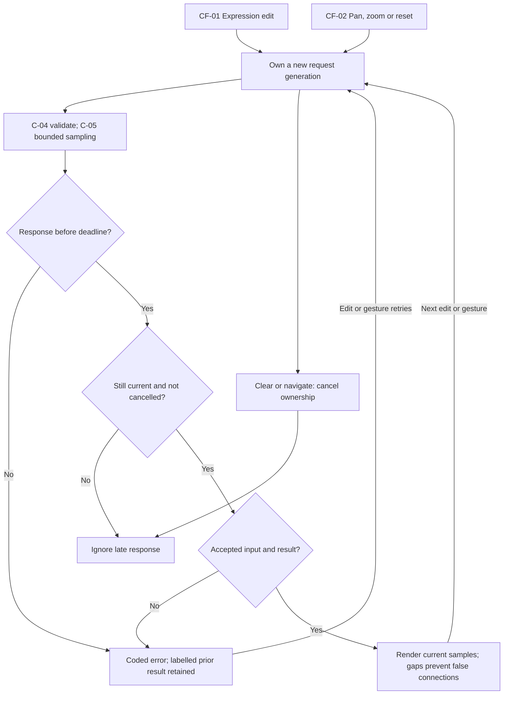

CF-03 — Matrix operation:

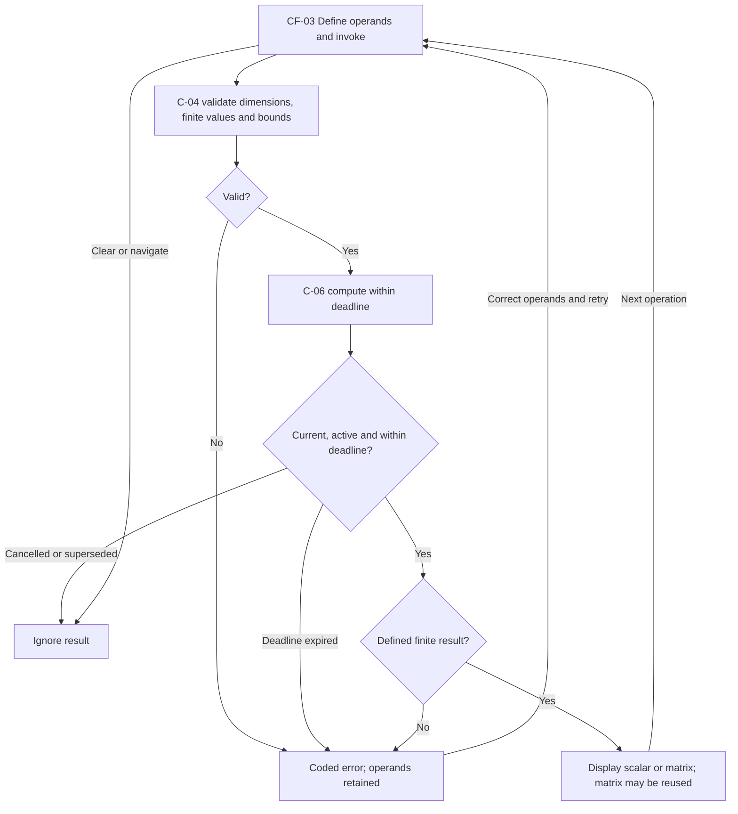

CF-04 — Topic, explicit reading, and progress:

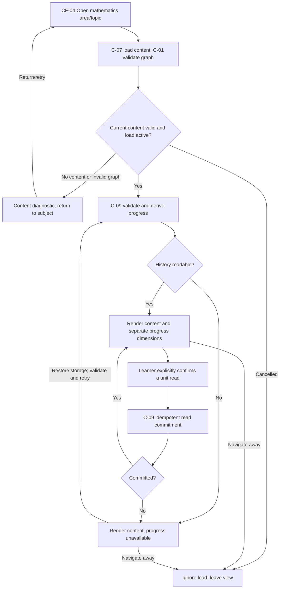

CF-05 — Exercise, grading, and durable recording:

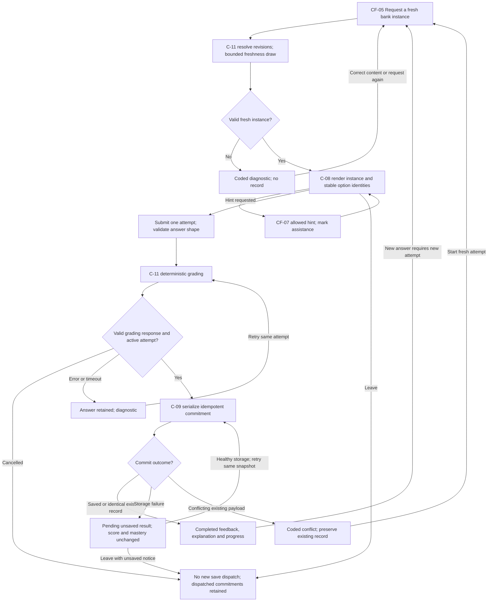

CF-06 — Self-test:

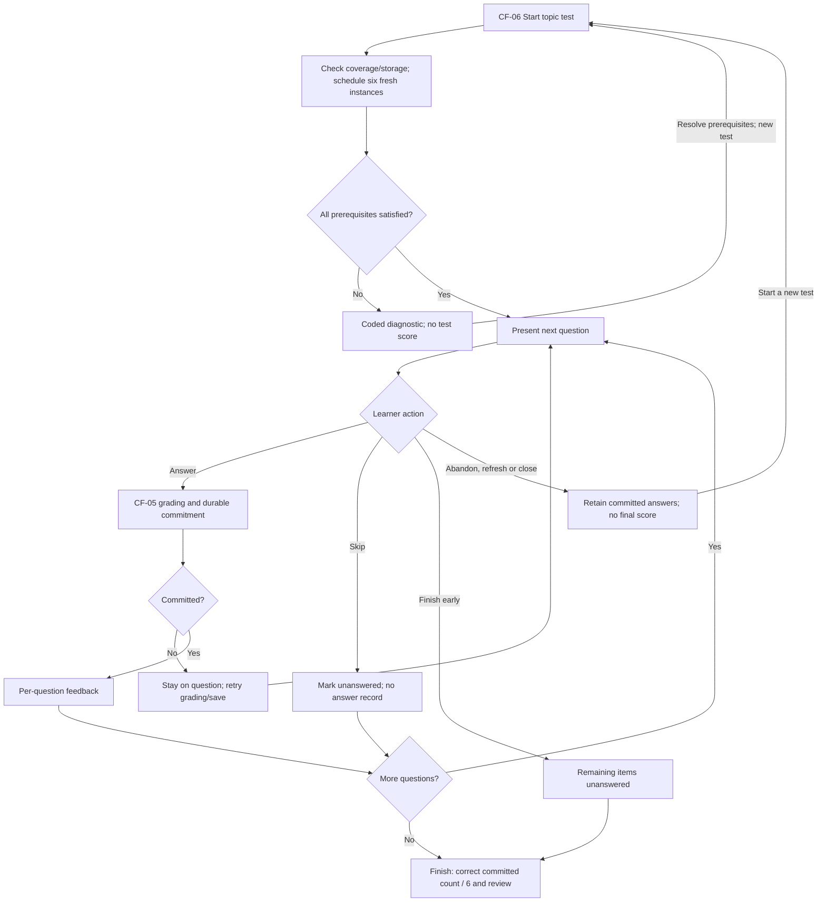

CF-07 — Mode-specific tutoring:

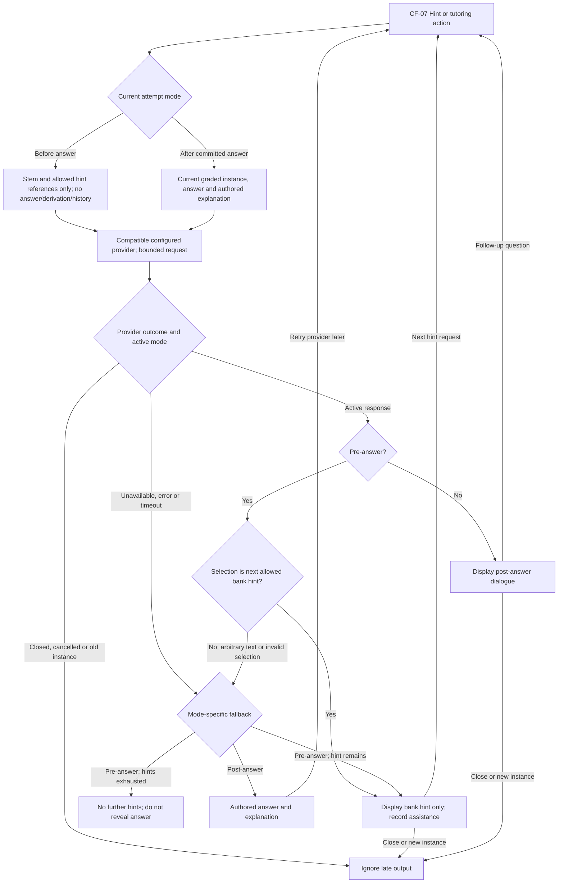

CF-08 — Authoring eligibility:

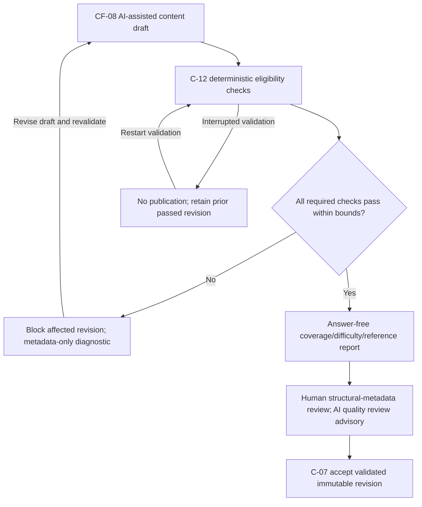

## Interaction Flow Design [Conditionally Required — a human or external system interacts with the solution]

The trigger applies. Each interaction has a table row and a sequence diagram
showing feedback, cancellation, failure, and recovery. CF-01 through CF-07
supply the corresponding system behavior.

| ID | Actor and entry state | Actions | System feedback and transitions | Exit state | Figma reference |
| --- | --- | --- | --- | --- | --- |
| IX-01 | Student entering the mathematics map | Browse three areas; freely open a topic; explicitly confirm individual units read; open a workspace | Six-topic baseline, separate read/mastery/coverage indicators, version-aware read confirmation and next topics; navigating away cancels obsolete loads | A topic studied, units confirmed, or a workspace opened | N/A — no Figma source exists |
| IX-02 | Student in the graph workspace | Edit expression, pan, zoom, reset | Current curve with axes/grid/gaps or coded error; prior curve labelled with its original context; clear or navigate away | An explored function or an empty workspace | N/A — no Figma source exists |
| IX-03 | Student in the matrix playground | Define matrices; choose operation; reuse matrix result | Finite result or coded diagnostic; inputs retained on failure; clear or navigate away | A computed result chain or cleared sheet | N/A — no Figma source exists |
| IX-04 | Student on a practice item | Open exercise; optionally request ordered hints; submit once; retry pending save; start fresh attempt | Fresh problem, assistance label, completed feedback and explanation only after commitment; leaving reports pending unsaved state; existing commits retained | A completed, durably recorded attempt | N/A — no Figma source exists |
| IX-05 | Student starting a self-test | Start the six-question topic test; answer/skip; finish or abandon | Progress, per-question committed feedback, score out of six and correct/incorrect/unanswered review; abandon/refresh ends the session without a final score | A finished test with score and review, or an abandoned test retaining commits | N/A — no Figma source exists |
| IX-06 | Student configuring tutoring | Set local endpoint/model/key; request method hints before answering or free-form help after completed grading | Compatible configuration status, ordered authored hints or current-instance dialogue, mode-specific fallback; close tutor; new instance isolates conversation | A configured tutor used safely, or fallback guidance | N/A — no Figma source exists |

### Mermaid Interaction Flow [Conditionally Required — Interaction Flow Design is triggered]

IX-01 — Study and explicit read confirmation:

IX-02 — Graph exploration:

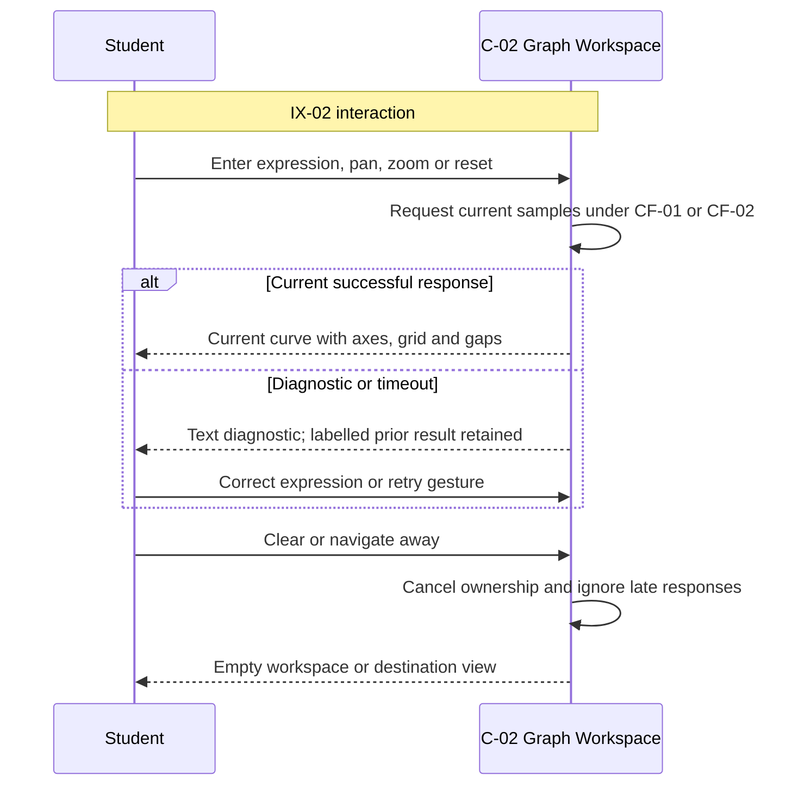

IX-03 — Matrix computation:

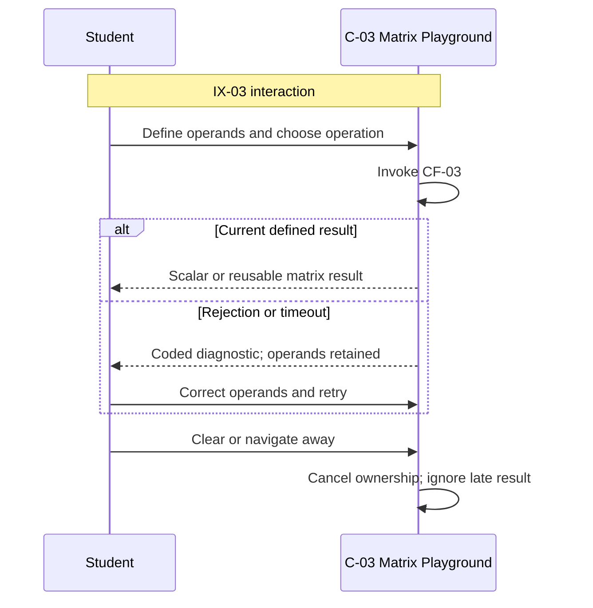

IX-04 — Practice and recording:

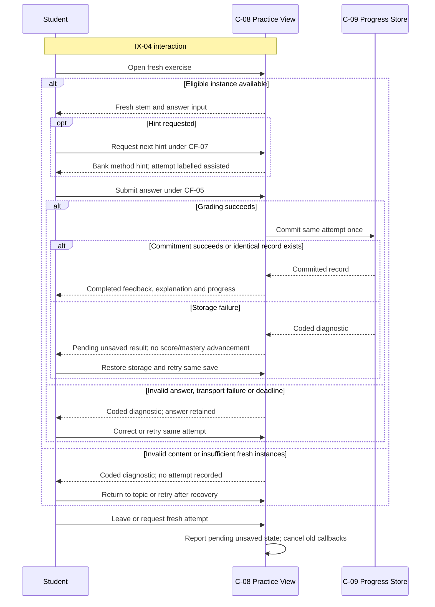

IX-05 — Six-question self-test:

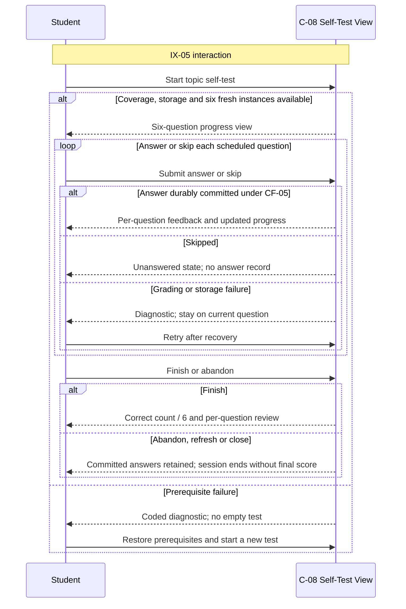

IX-06 — Tutor settings and disclosure modes:

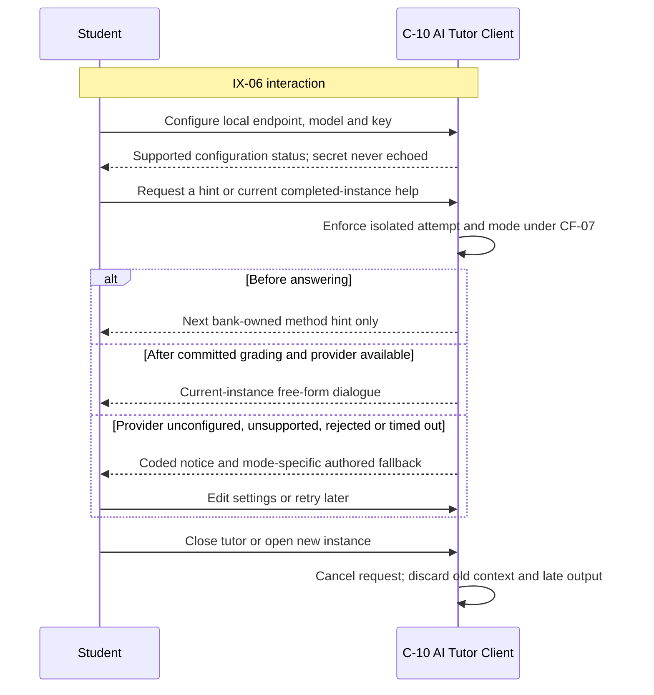

## Cross-Cutting Design [Required]

| Quality attribute | Solution-level design | Architecture-level validation |
| --- | --- | --- |
| Technology boundary (CON-01) | Backend C++20 and frontend TypeScript are fixed by D-03; frameworks, libraries, and provider protocols are ADR decisions within the approved boundaries | Each implementation ADR states its technology choices and they conform to CON-01 |
| Local-only deployment (CON-02) | The compute service is loopback-only, has no outbound runtime calls, and exposes no LAN or cloud deployment mode; the optional learner-configured AI provider does not host orange or its progress data | CAND-0001 acceptance evidence confirms no LAN listener through review of the service configuration |
| Determinism (CON-03) | Computation, synthesis, and grading are deterministic for their declared immutable revisions; replay includes revision identity, not seed alone | CAND-0003, CAND-0005, CAND-0007, and CAND-0009 acceptance checks replay identical requests |
| Performance budgets (CON-04) | p95 at most 200 ms for evaluation at the 1000-sample default and for each matrix operation through 50 x 50, and at most 100 ms for grading and synthesis, on reference local hardware; performance evidence uses 20 warm-ups and 100 serial requests per declared workload with nearest-rank p95 | The runtime ADR records reference hardware/OS/toolchain, request fixtures, and measurement scope; measured p95 satisfies each bound |
| Trust-boundary limits (CON-05) | Expression and answer payloads at most 1000 characters; at most 5000 samples; finite domain endpoints; matrix operands at most 50 x 50 with finite entries; exceeding a limit returns a coded diagnostic; parser complexity, concurrent work, and provider response bounds receive explicit finite limits in their ADRs | Boundary tests in CAND-0003, CAND-0005, and CAND-0011 submit over-limit inputs and observe coded diagnostics |
| Browser compatibility (CON-06) | Support the two most recent major versions of Chrome, Firefox, Safari and Edge on desktop at the implementation acceptance date; record tested browser/OS versions | Presentation ADRs record tested versions; compatibility does not imply shared storage across profiles or browsers |
| Deterministic diagnostics (CON-07) | Every user-visible failure has a deterministic code and readable text; messages and metadata-only reports contain no credentials or hidden correct answers | Diagnostic codes are asserted in the owning ADRs' acceptance checks |
| Accessibility (CON-08) | Navigation, read confirmation, graph and matrix entry, answers, self-tests, and tutoring controls are keyboard-operable; progress, selection, curve options, and errors have text descriptions and never rely only on color | Presentation ADR acceptance checks exercise keyboard paths and text alternatives |
| Secret hygiene (CON-09) | Tutor endpoint, model, and API key are learner-local settings; keys never enter repository content, diagnostics, logs, or answer snapshots; only explicitly supported provider protocols and destinations are configured; missing browser compatibility yields a coded unavailable state with authored fallback, not a new backend proxy boundary | CAND-0011 acceptance checks inspect outbound tutor context and key handling |
| Static asset bounds (CON-10) | Static SVG/PNG assets are at most 500 KB with validated references, formats, and safe rendering; parameterized exercises accept only assets whose parameter independence is mechanically verifiable; unverifiable assets may appear in study content but not parameterized exercise templates; human review remains structural metadata only | CAND-0016 validates asset provenance; GO-06 rejects unverifiable provenance |
| Outbound context allowlist (CON-11) | Outbound tutor context is an explicit allowlist for one current instance: stem/options, permitted point descriptions, current learner questions, and, only after commitment, that instance's submitted answer, correctness, and explanation; whole progress records, read history, unrelated attempts, and API keys in the body are excluded; the key authenticates only calls to the configured destination and redirects cannot forward credentials | CAND-0011 acceptance checks assert the allowlist and redirect rejection |
| Request deadlines (CON-12) | Client compute requests terminate loading after 2 seconds; tutor requests after 30 seconds; only the latest active graph/viewport or matrix request may repaint its view; closing, clearing, changing instance, or changing tutor mode invalidates prior callbacks; retries are learner-initiated; no unbounded automatic retries; server-side deadlines and overload rejection fit inside the client compute deadline | GO-09 and CAND-0004, CAND-0013, CAND-0017 acceptance checks exercise reversed, cancelled, and timed-out requests |
| Numeric answer rules (CON-13) | Numeric inputs accept finite decimal or scientific-notation scalars; symbolic expressions, non-finite values, and unit-bearing strings are rejected; each numeric template declares non-negative finite tolerances and a finite expected value; acceptance uses absolute error at most the larger of absolute tolerance and relative tolerance times the absolute expected value, inclusively; zero-valued expectations require an explicit absolute tolerance; choice answers use stable option identity; matrix ill-conditioning, overflow, and graph discontinuities produce explicit diagnostics or gaps | CAND-0007 and CAND-0009 boundary tests assert inclusive tolerance edges and rejections |
| Template domain validation (CON-14) | V1 templates use finite parameter domains with at most 1000 candidate tuples; binding validation examines the entire domain, checks constraints, at least three distinct valid problems per template and five per point, independently verifies each valid instance against structured stem conditions, checks unique choice correctness and distinguishable graph options, and rejects unchecked or unsupported semantics; the independent verifier must not reuse the runtime expected-answer derivation as its oracle | CAND-0016 runs exhaustive finite-domain validation and independent verification on fixtures |
| Hint safety (CON-15) | Method hints contain ordered abstract methods or rule references, not substituted final values, correct-option identities, or worked-solution steps; pre-answer display is restricted to this validated content; numerical worked steps are checked against the structured problem and pedagogical prose quality is advisory-AI reviewed; machine validation does not prove every natural-language explanation's educational correctness — that residual limitation is explicitly part of this Draft baseline | CAND-0016 hint checks and GO-07 pre-answer disclosure checks |
| Inert rendering (CON-16) | Local API origins and all inputs are validated independently of the no-account product boundary; content and AI output render as constrained inert content; scripts, active SVG behavior, and untrusted HTML cannot execute | CAND-0002 content contract and CAND-0011 response handling assert inert rendering |

## Assumptions And Open Questions [Conditionally Required — assumptions or material questions exist or were resolved during drafting]

| ID | Assumption or question | Owner | Status | Resolution and evidence |
| --- | --- | --- | --- | --- |
| A-1 | Browser-local progress may be lost by external data clearing, private browsing, profile changes, or origin changes, and V1 provides no export/import/backup/synchronization | @hailingu | Resolved | Accepted as a V1 boundary (PR-11, NG-05); loss recovery is explicitly out of scope |
| A-2 | Machine validation cannot prove the educational correctness of every natural-language explanation | @hailingu | Resolved | Accepted residual limitation recorded in CON-15; advisory AI review covers prose quality without becoming a correctness gate |
| A-3 | The shared ADD template and governance validator were absent when this document was first drafted | @hailingu | Resolved | The owner restored the template family and adopted the validator through docs/adr/ADR-0002-governance-validator-adoption.md; this document was aligned to the restored template structure on 2026-10-13 with semantics, statuses, and index identity unchanged |
| A-4 | Whether this Draft becomes the V1 design baseline | @hailingu | Open | Requires the exact `Approve` under the AGENTS.md approval contract before Design Status may become `Current`; until then no candidate is selectable |

## Risks And Trade-Offs [Required]

| ID | Risk or trade-off | Impact | Mitigation |
| --- | --- | --- | --- |
| R-1 | Authoring an initial bank of at least 24 validated parameterized templates with hints and explanations is substantial content work | CAND-0018 may become the schedule-critical path late in V1 | Author tooling (CAND-0016) lands before bulk authoring; coverage minima are explicit in Initial Mathematics Content Coverage |
| R-2 | Browser-local storage is the single durable progress store | Storage corruption or data clearing can end progress continuity | PR-10 progress-unavailable state, integrity checks, and recovery validation; PR-11 states the accepted loss boundary |
| R-3 | The optional AI tutor depends on a learner-configured external provider | Provider drift could break the tutoring experience | CON-09/CON-11 allowlist, coded unavailable states, and authored fallback keep every graded outcome offline and deterministic (INV-14) |
| R-4 | Eighteen dependency-ordered task candidates lengthen the V1 critical path | Late candidates (content, tutoring) cannot start before their dependencies merge | Dependency columns are explicit; presentation candidates are deliberately lightweight to parallelize after their backend contracts |
| R-5 | One Draft ADD carries the whole V1 baseline; later demand drift could invalidate it | Reapproval churn | Baseline last-checked discipline in Acceptance-Outcome Baseline; drift is reported and revised deliberately rather than silently merged |

## ADR Task Candidates [Required]

Allowed task-candidate statuses: `Ready`, `Selected`, `Complete`, or `Deferred`.

Every candidate is `Ready` as a Draft proposal and becomes eligible for
selection only once this ADD is `Current`. Each row owns one complete outcome,
one primary implementation boundary, and one implementation pull request.
Supporting interfaces are limited to the named outcome. No row authorizes
implementation, a governed build, or deployment. The exact repository-relative
ADR path remains unassigned until reciprocal selection is made atomically.

| ID | Complete outcome | Scope boundary | Dependencies | Acceptance context | Recommended ADR type | Status | Status reason or evidence | ADR path |
| --- | --- | --- | --- | --- | --- | --- | --- | --- |
| CAND-0001 | One documented local runtime path serves the TypeScript client and loopback C++20 health endpoint through a stable browser origin | Runtime assembly; no domain features or remote deployment tooling | None | Clean local checkout starts both sides, the client reaches the health endpoint, and ordinary restart preserves the origin; no LAN listener | Full | Selected | Selected by docs/adr/ADR-0003-local-runtime-path.md (Proposed); the ADR's Architecture Source records this ADD path and candidate ID in the same change | docs/adr/ADR-0003-local-runtime-path.md |
| CAND-0002 | A versioned content contract represents topic/unit/point mappings, immutable template revisions, stable options, hints, assets and validation eligibility | Persistence / data behavior (repository content); no learner UI or validation-tool implementation | CAND-0001 | Content fixtures represent every declared entity and revision relationship without dangling identifiers; historical revisions retain interpretable identity | Full | Ready | N/A — Ready | None |
| CAND-0003 | Safe bounded evaluation returns samples/gaps or coded diagnostics through the required minimal API interface | Domain / application policy (backend evaluation) | CAND-0001 | Identical revision-bound requests match, invalid/oversized expressions are rejected, and known discontinuities never yield a connecting segment | Full | Ready | N/A — Ready | None |
| CAND-0004 | Interactive graph workspace renders current samples and axes/grid, supports pan/zoom/reset/edit, and handles deadlines and obsolete results | Presentation (graph workspace); consumes the existing evaluation contract | CAND-0001, CAND-0003 | Each gesture updates the view; reversed responses retain the latest result; clear and timeout satisfy GO-09 | Lightweight | Ready | N/A — Ready | None |
| CAND-0005 | Six pure matrix operations return defined results or dimension/singularity/numerical diagnostics through a minimal API interface | Domain / application policy (backend matrix); no matrix playground UI | CAND-0001 | Each operation succeeds on declared compatible fixtures; incompatible, singular and non-finite cases return distinct diagnostics within bounds | Full | Ready | N/A — Ready | None |
| CAND-0006 | Local answer/read persistence provides serialized idempotent commits, immutable snapshots, commit-time freshness checks, integrity/error states and revision-aware progress reductions | Persistence / data behavior (local progress); no map or practice UI | CAND-0002 | Restart, duplicate/two-tab commits, failed writes, assisted/non-fresh answers and changed content satisfy GO-01 through GO-05 and GO-10 at the storage boundary | Full | Ready | N/A — Ready | None |
| CAND-0007 | Deterministic grading resolves authoritative bank instances and stable choice identities or numeric tolerance | Domain / application policy (backend grading); no practice UI or authoring validator | CAND-0002, CAND-0009 | Correct/incorrect answers and tolerance boundaries are deterministic; forged expected answers and invalid payloads are rejected; shuffled choice positions do not alter correctness | Full | Ready | N/A — Ready | None |
| CAND-0008 | Six-question topic test assembly, answering/skipping, committed scoring and review obey ST-01 through ST-06 | Presentation (self-test); existing practice, instance and persistence contracts unchanged | CAND-0015 | The 4/6 and interrupted-test scenarios satisfy GO-08; empty coverage and insufficient fresh instances prevent starting; refresh retains committed answers | Lightweight | Ready | N/A — Ready | None |
| CAND-0009 | Revision-bound seeded synthesis resolves authoritative templates, derives answers and option identities/order, and terminates freshness redrawing | Domain / application policy (backend synthesis) | CAND-0002, CAND-0003, CAND-0005 | Same revision/seed reproduces the instance; materially repeated problems fail freshness; 32 exhausted candidates satisfy GO-05 without a record | Full | Ready | N/A — Ready | None |
| CAND-0010 | Existing graph-choice content renders accessible distinct 2D mini-curves with stable selection in practice and self-test | Presentation (graph-choice options); no new grading or content contract | CAND-0003, CAND-0004, CAND-0015, CAND-0008 | Declared graph options render within their shared window in both views; keyboard selection and shuffled identities grade identically to equivalent plain choices | Lightweight | Ready | N/A — Ready | None |
| CAND-0011 | Optional browser AI provider integration owns local configuration storage, permitted context, bounded calls, hint-selection rejection and safe authored fallback | Provider / transport integration (AI client); no tutoring view implementation or backend proxy | CAND-0002, CAND-0007, CAND-0009 | Controlled provider responses satisfy GO-07; unconfigured, incompatible, timed-out and redirected calls preserve fallback and secret boundaries | Full | Ready | N/A — Ready | None |
| CAND-0012 | Mathematics navigation and topic rendering consume the content contract, validate maps, present notation/assets/coverage and open workspaces | Presentation (study navigation); no content authoring or progress reducer | CAND-0002 | Valid two-topic fixtures present advisory order and next topics; any topic opens freely; missing/cyclic/dangling content produces coded error states | Lightweight | Ready | N/A — Ready | None |
| CAND-0013 | Matrix playground edits operands, invokes six existing operations, displays/reuses results and handles cancellation/deadlines | Presentation (matrix playground); no new computation or API contract | CAND-0005 | Every existing operation is invocable; diagnostics preserve operands; clear/obsolete-response behavior satisfies GO-09 | Lightweight | Ready | N/A — Ready | None |
| CAND-0014 | Topic/map read and mastery indicators, explicit read confirmations and unavailable-progress feedback consume the existing progress contract | Presentation (progress views); no storage or scoring policy changes | CAND-0006, CAND-0012 | Multi-mapped units, assisted/wrong answers, revision changes and recovery visibly satisfy GO-01, GO-03, GO-04 and GO-10 with separate dimensions | Lightweight | Ready | N/A — Ready | None |
| CAND-0015 | Plain-choice and numeric practice materialize current instances, capture one answer, commit before feedback, preserve failed/pending attempts and expose existing hint hooks | Presentation (practice); no synthesis/grading/validator implementation | CAND-0006, CAND-0007, CAND-0009, CAND-0012, CAND-0016 | Choice and numeric attempts show explanations only after commitment; duplicate, failure, stale-freshness and save recovery satisfy GO-02, GO-05 and GO-10 | Lightweight | Ready | N/A — Ready | None |
| CAND-0016 | One authoring eligibility tool checks the fixed content contract, finite-domain correctness with an independent oracle, option/graph validity, hints/assets, coverage and answer-free reports | Authoring provider / tool integration; no runtime UI or initial bank authoring | CAND-0002, CAND-0003, CAND-0005, CAND-0007, CAND-0009 | Valid fixtures become eligible; each GO-06 defect blocks the affected revision; no deep content or answers appear in the human metadata report | Full | Ready | N/A — Ready | None |
| CAND-0017 | Tutor settings and conversation/hint views consume the AI integration and current practice context, label assistance and enforce view/mode cancellation | Presentation (tutoring); no new provider or grading policy | CAND-0011, CAND-0015 | Configured multi-turn dialogue, safe unconfigured pre/post fallback, new-instance isolation and closed-view late responses satisfy GO-07 and GO-09 | Lightweight | Ready | N/A — Ready | None |
| CAND-0018 | One validated initial mathematics content pack supplies MC-01 through MC-06, twelve mapped points, at least 24 templates and required kinds/hints | Persistence / data behavior (initial study content); no tooling, schema or UI changes | CAND-0002, CAND-0016 | Metadata report confirms all Initial Mathematics Content Coverage minima, declared learning edges, two graph topics and passed eligibility for every published revision | Full | Ready | N/A — Ready | None |

## Traceability [Required]

| Requirement | Capabilities | Data entities | Components | Control / interaction flows | ADR task candidates |
| --- | --- | --- | --- | --- | --- |
| D-01, D-16 | CAP-01, MC-01 through MC-06 | E-01 through E-06 | C-01, C-07, C-12 | CF-04, IX-01 | CAND-0002, CAND-0012, CAND-0016, CAND-0018 |
| D-02 | CAP-02, CAP-03, CAP-04, GO-09 | E-09, E-10 | C-02, C-04, C-05 | CF-01, CF-02, IX-02 | CAND-0003, CAND-0004 |
| D-01 (matrix study) | CAP-05, MC-05, MC-06 | E-11, E-12 | C-03, C-04, C-06, C-07 | CF-03, IX-03 | CAND-0005, CAND-0013, CAND-0018 |
| D-03, D-04, D-15 | CAP-06, AO-03 | E-01 through E-20 | C-01, C-04, C-07 | CF-04, IX-01 | CAND-0001 |
| D-05 | CAP-01, CAP-09, CAP-10 | E-02, E-16, E-17 | C-01, C-07, C-09 | CF-04, IX-01 | CAND-0002, CAND-0012, CAND-0014, CAND-0018 |
| D-06 | CAP-06, INV-04, CON-02 | E-13, E-14, E-18 | C-01, C-04, C-09, C-10 | CF-04, CF-07, IX-01 | CAND-0001, CAND-0006, CAND-0011 |
| D-07 | CAP-07, CAP-08, CAP-09, ST-01 through ST-06, GO-02, GO-08 | E-07, E-08, E-13, E-15, E-16 | C-04, C-08, C-09, C-11 | CF-05, CF-06, IX-04, IX-05 | CAND-0006, CAND-0007, CAND-0008, CAND-0009, CAND-0015 |
| D-08 | INV-17, CF-08, GO-06 | E-07, E-20 | C-07, C-11, C-12 | CF-08 | CAND-0002, CAND-0016, CAND-0018 |
| D-09 | CAP-07, CAP-08, PR-05, PR-06, GO-05 | E-07, E-08, E-13 | C-08, C-09, C-11, C-12 | CF-05, CF-06, CF-08 | CAND-0006, CAND-0009, CAND-0015, CAND-0016 |
| D-10 | CAP-09, CAP-10, PR-01 through PR-04, GO-01 | E-04, E-05, E-13, E-14, E-16, E-17 | C-01, C-07, C-09 | CF-04, IX-01 | CAND-0002, CAND-0006, CAND-0014, CAND-0018 |
| D-11 | INV-12, PR-03, GO-03 | E-13, E-16 | C-09 | CF-05 | CAND-0006, CAND-0014 |
| D-12 | CAP-07, MC-02, MC-04 | E-07, E-09, E-10 | C-04, C-05, C-08, C-12 | CF-05, CF-06, CF-08 | CAND-0003, CAND-0010, CAND-0016, CAND-0018 |
| D-13 | CAP-01, CAP-07, CON-10, GO-06 | E-06 | C-01, C-07, C-08, C-12 | CF-04, CF-05, CF-08 | CAND-0002, CAND-0012, CAND-0015, CAND-0016, CAND-0018 |
| D-14 | CAP-11, CF-07, IX-06, GO-07 | E-18, E-19 | C-08, C-10 | CF-07, IX-06 | CAND-0011, CAND-0017 |
| D-17 | AO-05, GO-01 through GO-10, PR-01 through PR-12, CON-12 through CON-16 | E-01 through E-20 as applicable | C-01 through C-12 as applicable | CF-01 through CF-08, IX-01 through IX-06 as applicable | CAND-0002 through CAND-0018 as applicable |

## Supporting Material [Optional]

### Delegated Decisions [Optional]

Only implementation choices that preserve the approved outcomes remain
here. Changing the read trigger, fixed mastery threshold, freshness rule,
assistance treatment, six-question score, or disclosure modes requires ADD
revision and approval rather than an implementation-only ADR override.

| ID | Question | Delegated to | Why ADD-level content is invariant |
| --- | --- | --- | --- |
| DD-01 | Bundle content with the client or deliver it through the local service | CAND-0002 ADR | C-07 remains read-only and resolves the same validated revisions on both sides |
| DD-02 | Exact expression grammar and operator/function enumeration | CAND-0003 ADR | It must cover all numerical expressions required by MC-01 through MC-06 and graph-choice content, preserve safe rejection and bounded sampling |
| DD-03 | Sampling and renderer implementation, including permitted client caching/refinement | CAND-0003 and CAND-0004 ADRs | Current-request authority, discontinuity gaps, server-authoritative results and resource bounds remain fixed |
| DD-04 | Learning-map and unit/point mapping authoring representation | CAND-0002 ADR | Acyclic complete maps, stable identities, explicit mappings and advisory ordering remain fixed |
| DD-05 | Browser-local persistence technology and transaction/serialization mechanism | CAND-0006 ADR | No export feature or server store is introduced; idempotent durable commits, history integrity and revision-aware reduction remain fixed |
| DD-06 | Per-template numeric tolerance values and matrix numerical-failure thresholds | CAND-0007 and CAND-0005 ADRs | The inclusive tolerance rule, finite inputs and explicit numerical diagnostics remain fixed; values must be precise before ADR acceptance |
| DD-07 | Seed encoding, finite-domain constraint representation and fingerprint mechanics | CAND-0009 ADR | Reproduction includes immutable revisions; material freshness, stable option identities and 32-candidate termination remain fixed |
| DD-08 | Eligibility-tool invocation, independent verification technique and report encoding | CAND-0016 ADR | Exhaustive bounded eligibility, independent stem/answer verification and metadata-only human review remain fixed |
| DD-11 | Supported AI protocol, model capabilities, key-storage mechanics and post-answer response delivery | CAND-0011 ADR | Browser-only provider integration, configured-destination limits, mode-specific context, bank-owned hints and safe fallback remain fixed |

DD-09 is resolved: exactly three independent correct assessments, with no
threshold override. DD-10 is withdrawn from V1: initial bank entry uses direct
repository authoring; bulk-import converter tooling requires later scope.

### Revision Review And Verification [Optional]

Review date: 2026-10-12 (gap-review revision); template alignment 2026-10-13.
Reviewing/drafting actors: `@codex` (gap review), `@zcode` (template
alignment). This is Draft revision evidence, not approval evidence or proof
that V1 is implemented.

| Review area | Result and evidence |
| --- | --- |
| Classification and authority | Architecture Design Documentation only. The original task branch was retained; only this ADD and its index row changed. No ADR, source, configuration, dependency, build, deployment or approval state was created or changed by the Draft itself. |
| Scope and baseline | D-15/D-16 explicitly capture owner clarification. Initial Mathematics Content Coverage covers mathematics only; physics/chemistry remain later scope. Optional AI calls do not create a hosted orange deployment. Concrete choices under D-17 remain Draft proposals awaiting this document's approval. |
| Requirement levels | All top-level sections carry an explicit requirement level. Control and interaction triggers apply and have tables and diagrams. The only incomplete lifecycle fields are the permitted Draft approval metadata; no functional rule or candidate field is Pending. |
| Solution completeness | Point/unit mappings, primary assessment attribution, fixed threshold, assisted-answer treatment, commit ordering, revision snapshots, storage failure/recovery, freshness, test scoring, hint disclosure and late-response behavior have explicit owners and observable outcomes. Known browser data loss and prose-validation limits are stated in PR-11 and CON-15. |
| Task boundaries and traceability | Eighteen candidates have one declared primary boundary, dependencies, acceptance context, type, status and eventual ADR field. Runtime synthesis/grading, authoring validation, content, storage and presentation are separately reviewable. Dependency relationships are acyclic; demanded capabilities and GO-01 through GO-10 have candidate owners. |
| Diagrams and index | All fourteen Mermaid blocks passed Mermaid 10.8.0 parsing and SVG rendering after escaping literal message semicolons in the six sequence diagrams. Parsed diagram models cover the twelve component IDs, eight control-flow IDs and six interaction IDs; rendered SVGs have valid XML and positive finite dimensions. The template alignment of 2026-10-13 preserved every diagram, label, actor, branch, ordering and table agreement. |
| Configured governance verification | The checks required by AGENTS.md Scope Routing were attempted at the 2026-10-12 revision and exited 254 with ENOENT because the validator package did not exist then. The validator was adopted and localized on 2026-10-13 by docs/adr/ADR-0002-governance-validator-adoption.md; its two commands now run against this document, and this row is updated with their actual result in that ADR's evidence. |
| Repository prerequisites | docs/README.md, the shared templates, and docs/adr/INDEX.md were absent at the 2026-10-12 revision; the owner restored the templates and README before ADR-0001 acceptance, and this ADD was aligned to the restored template on 2026-10-13. |

## Approval And Review Checklist [Required]

- [x] Scope routing, filename, number, metadata, and central index row are correct.
- [x] Every demand source has a captured baseline, acceptance outcome, and last-checked date.
- [x] Every functional capability cites captured requirement IDs, and every stated behavior traces to those cited baselines.
- [x] Data Model Design ownership, lifecycle, sensitivity, relationships, and invariants are populated (trigger applies).
- [x] Every architecture component has a responsibility, conceptual inputs and outputs, dependencies, and cited accepted constraints; the required Mermaid architecture diagram covers every component ID, boundary, dependency, and applicable conceptual flow and agrees with the table.
- [x] Every triggered control or interaction section includes its required Mermaid diagram and structured table; the diagram covers every declared flow ID plus applicable ordering or transitions, branches, feedback, failure, and recovery, and agrees with the table. Each untriggered section records `N/A — <reason>`.
- [x] UI scope cites exact accessible design context or records its N/A reason and does not override it.
- [x] Cross-cutting concerns, risks, and assumptions are documented with their treatment, and every material question is resolved.
- [x] Traceability connects every requirement to capabilities and ADR task candidates.
- [x] Task candidates contain outcomes and boundaries but no implementation details; every source or configuration candidate fits one independently reviewable implementation pull request, with larger work split into dependency-ordered candidates.
- [x] Every `Selected` or `Complete` candidate has an exact ADR path, and that ADR's `Architecture Source` points back to this ADD path and candidate ID.
- [x] Every required section is complete; every conditional trigger is assessed and completed or marked `N/A — <reason>`; optional sections are complete or removed.
- [x] `npm run validate --prefix tools/governance-validator` passes, including template-field, status, index, reciprocal-link, Mermaid syntax, and diagram/table ID checks.
- [x] An eligible non-author approver, approval time, and exact `Approval Evidence: Approve` are recorded before `Current`; any optional Approval Context Revision is informational, non-binding, and exactly represents the approved document.

## Archival [Conditionally Required — Design Status is `Deprecated` or `Superseded`]

When Design Status becomes `Deprecated` or `Superseded`, archive this ADD in
the same change. Before that trigger, retain this section as inactive
future-lifecycle guidance; its checklist does not affect `Current` status. When
triggered:

- [ ] Confirm every candidate is `Deferred` or `Complete`, no linked ADR has a non-terminal Implementation Status, and all reciprocal paths are current.
- [ ] Move it to `archive/ADD-0001-orange-v1-baseline.md` under this architecture root.
- [ ] Update all ADR, ADD, code, documentation, and task-candidate references to its final path.
- [ ] For supersession, set reciprocal `Supersedes` and `Superseded By` paths.
- [ ] Update its single row in `docs/architecture/INDEX.md`; never delete the row.
- [ ] Confirm no non-archived ADD/ADR or governed marker still cites the pre-archive path.

## Change Log [Required]

| Date | Change | Author |
| --- | --- | --- |
| 2026-10-12 | Initial Draft created on branch `docs/add-0001-orange-v1-baseline` from local `dev` | @zcode |
| 2026-10-12 | Added learning-path knowledge ordering per repository owner feedback: each subject area manages its learning order as a directed acyclic learning-path graph presented as a flowchart knowledge map (advisory order, deterministic validation, INV-07/INV-08) | @zcode |
| 2026-10-12 | Raised the personal-tool boundary from a V1 non-goal to a product-level exclusion (D-06, NG-01, INV-04): no accounts, authentication, authorization, or multi-user capability in any version | @zcode |
| 2026-10-12 | Added practice, self-testing, and mastery assessment (D-07, CAP-07 through CAP-09, CF-05/CF-06, IX-04/IX-05, CAND-0006 through CAND-0008, INV-09/INV-10); INV-03 permits a client-side append-only answer history with incremental per-question recording | @zcode |
| 2026-10-12 | Fixed the exercise content stance and anti-memorization design (D-08, D-09, NG-08): the repository-versioned bank is the sole runtime content source with AI assisting only at authoring time, and exercises are parameterized templates presenting freshly drawn seeded instances per attempt (INV-11, CAND-0009, DD-07) | @zcode |
| 2026-10-12 | Fixed the authoring venue and resolved the self-review paradox (D-08): tiered no-exposure review — deterministic machine validation with independent numeric cross-verification is the binding gate, AI review is advisory, human review is structural-metadata only | @zcode |
| 2026-10-12 | Closed the progress-management gaps (D-10 through D-12, CAP-10, INV-12/INV-13): knowledge-point granularity with coverage views, streak-based mastery, client-side read tracking with two-dimension progress, and graph-choice options rendered as 2D mini-curves (CAND-0010) with 3D deferred (NG-09) | @zcode |
| 2026-10-12 | Formalized question-bank entry and image handling (D-13, CON-10, NG-10, NG-11): entry exclusively via the repository authoring workflow, ContentAsset static images machine-validated, parameter-agnostic rule for images in parameterized templates | @zcode |
| 2026-10-12 | Added runtime AI tutoring with authored fallback (D-14, CAP-11, C-10, CF-07, IX-06, CAND-0011, INV-14/INV-15, CON-09/CON-11): learner-local AI configuration never enters the repository, hint mode excludes the expected answer from request context, and grading and mastery remain offline and deterministic | @zcode |
| 2026-10-12 | Applied owner clarification and authorized gap-review revision: local-only deployment (D-15), initial mathematics-only scope (D-16), and Draft gap-closure choices (D-17). Added six-topic coverage, six-question self-test rules, explicit point-level reading/assessment, independent fixed-three mastery, assisted-answer treatment, version-bound durable history, idempotent commits and storage recovery, bounded freshness and request lifecycles, independent bank validation and safe mode-specific tutoring. Added C-11/C-12, synchronized flow tables/diagrams, narrowed CAND-0001 through CAND-0011 and added CAND-0012 through CAND-0018. Closed DD-09 and removed bulk import from V1; remained Draft with no approval or implementation authorization | @codex |
| 2026-10-12 | Reproduced Mermaid 10.8.0 parse failures in IX-01 through IX-06 and escaped literal message semicolons with Mermaid character entities. All fourteen diagrams then passed parsing and SVG rendering with Mermaid 10.8.0. Diagram labels, IDs, actors, branches, ordering and Draft status were preserved | @codex |
| 2026-10-13 | Aligned this document to the restored ADD template structure as part of ADR-0002's adoption change: template section set, Metadata field syntax, entity IDs E-01 through E-20, and index-identity fields change form only; Design Status remains Draft, every capability, rule, invariant, diagram, candidate, and traceability row preserves its meaning, and the index row is unchanged in substance | @zcode |
| 2026-10-13 | Rename interaction-flow IDs IF-01 through IF-06 to IX-01 through IX-06 to satisfy the restored template's interaction-ID contract (table and diagram labels unchanged in meaning) | @zcode |
| 2026-10-13 | Record approval per repository owner @hailingu's exact Approve: Design Status Draft→Current with approval metadata and an informational approval context revision; resolve open question A-4; check the approval and review checklist; update the architecture index row in the same change. The eighteen ADR task candidates become eligible for selection | @zcode |
| 2026-10-13 | Select CAND-0001 (Ready→Selected) with the reciprocal ADR path docs/adr/ADR-0003-local-runtime-path.md; the ADR's Architecture Source records this document and CAND-0001 atomically. Permitted status transition; approval-preserving | @zcode |
