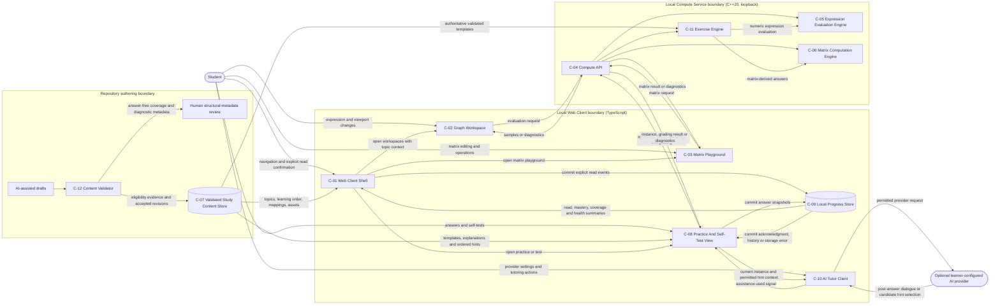
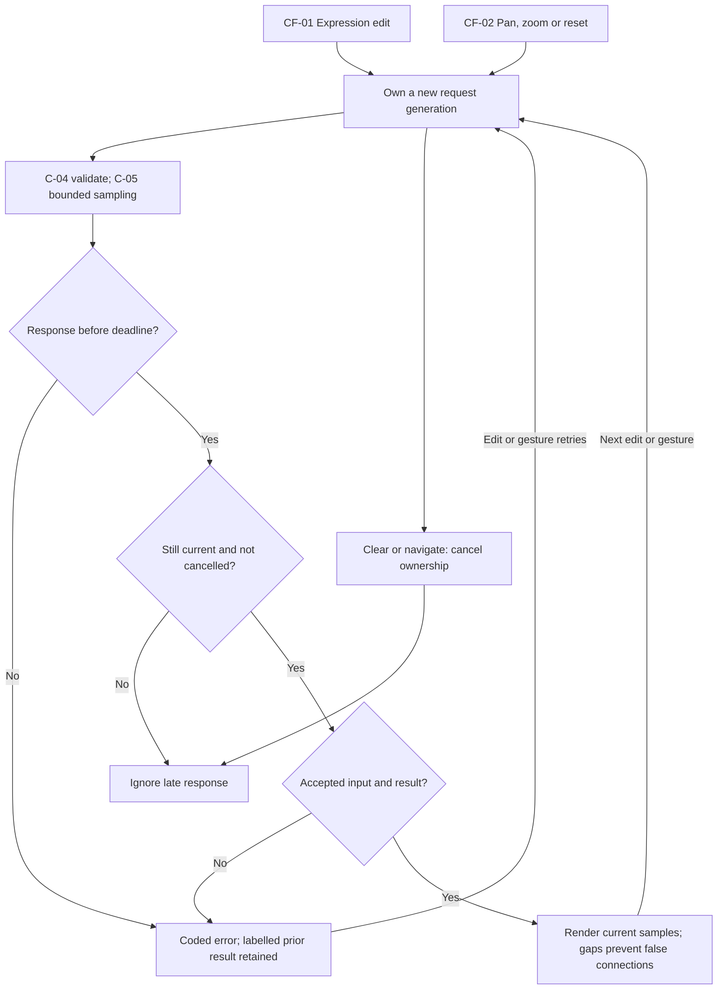
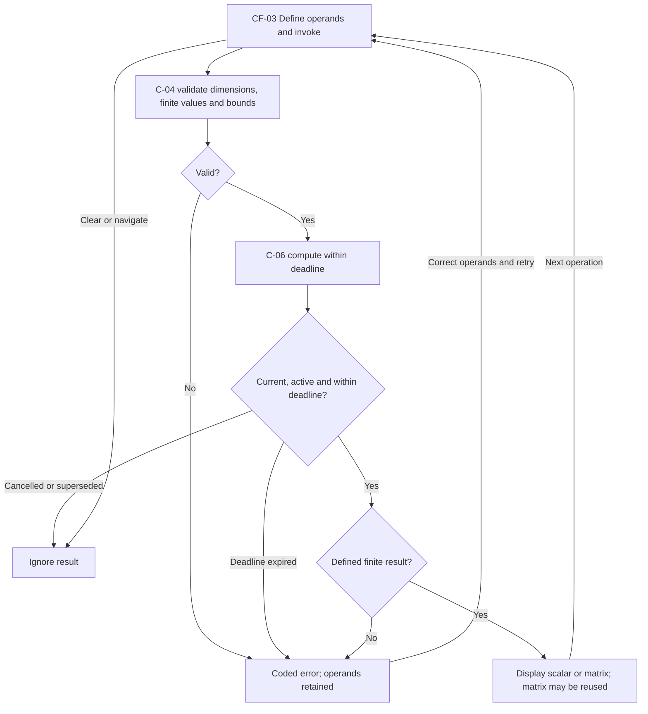
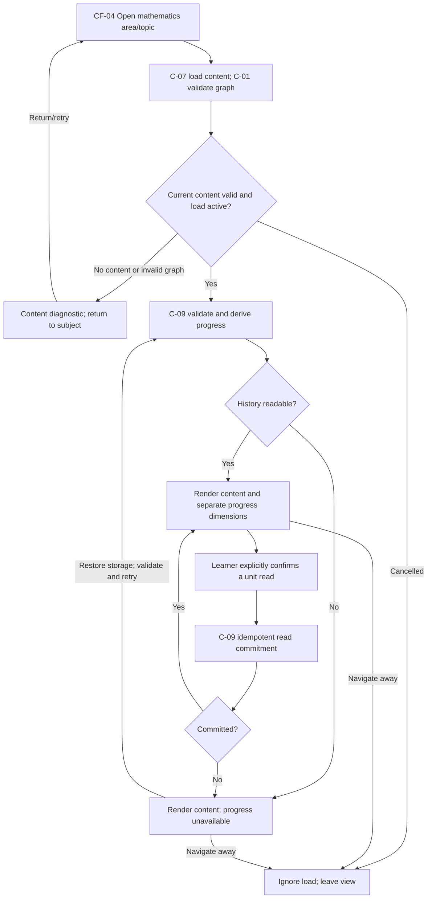
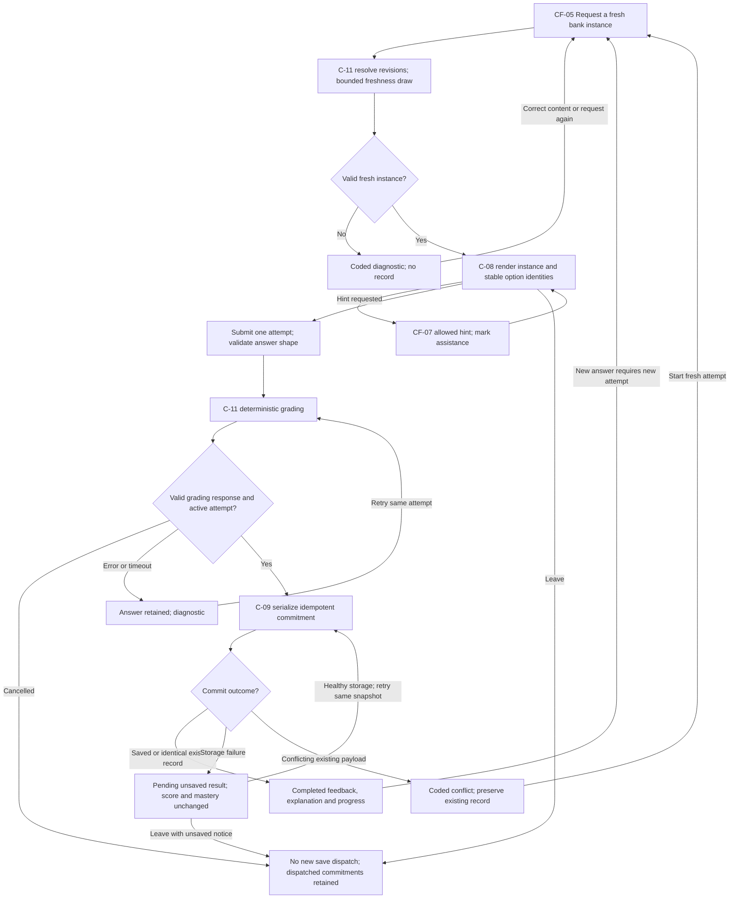
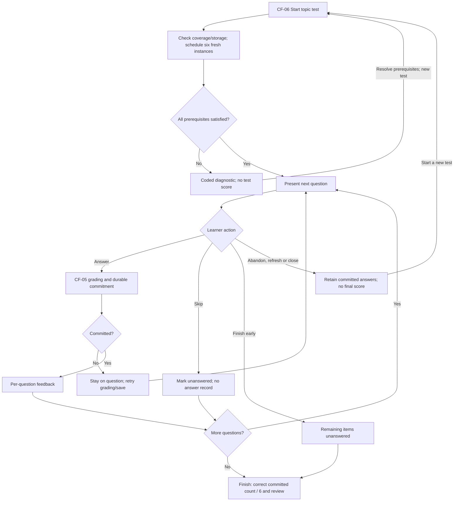
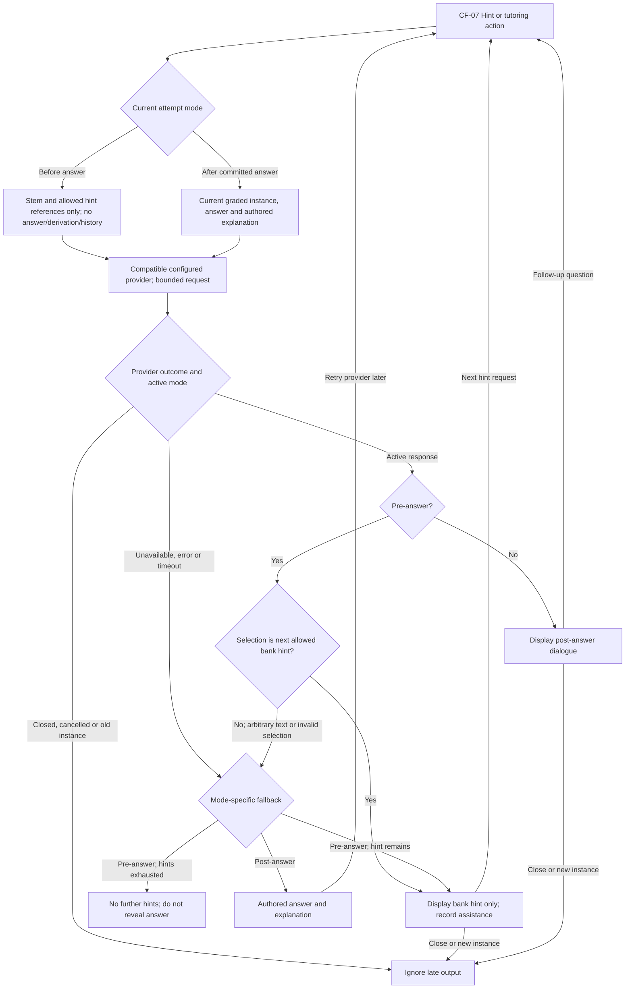
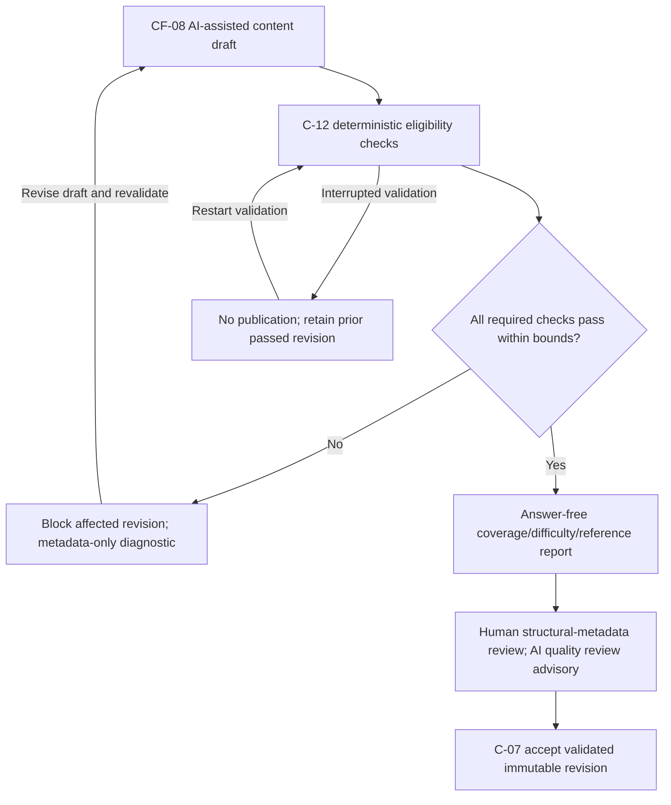
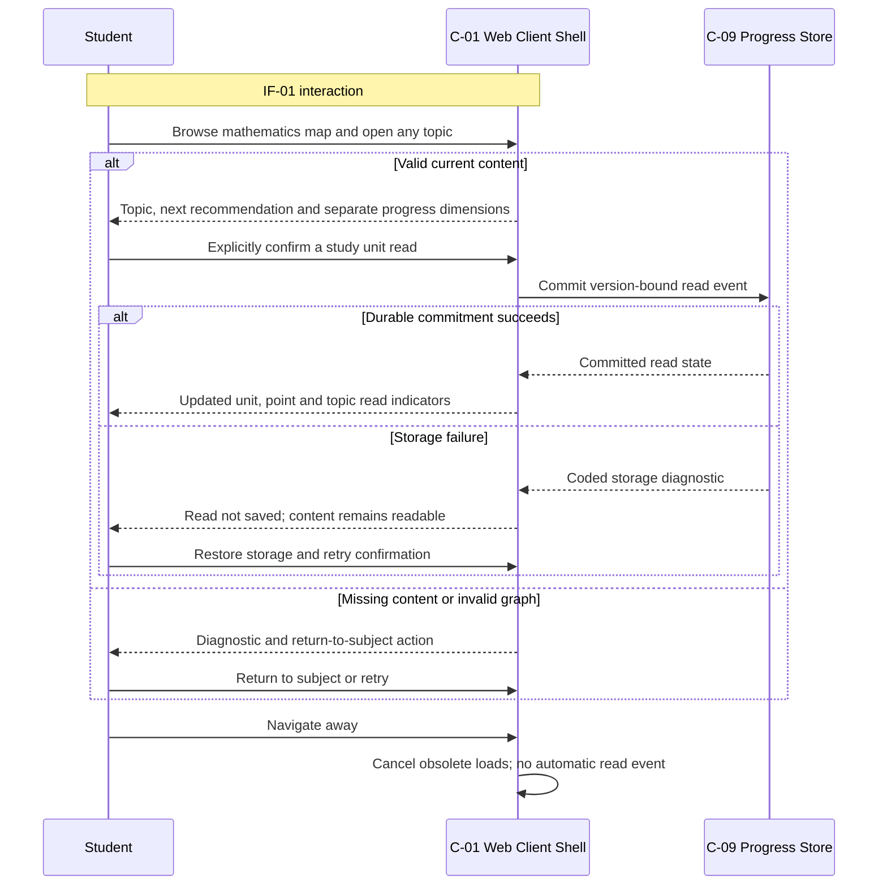
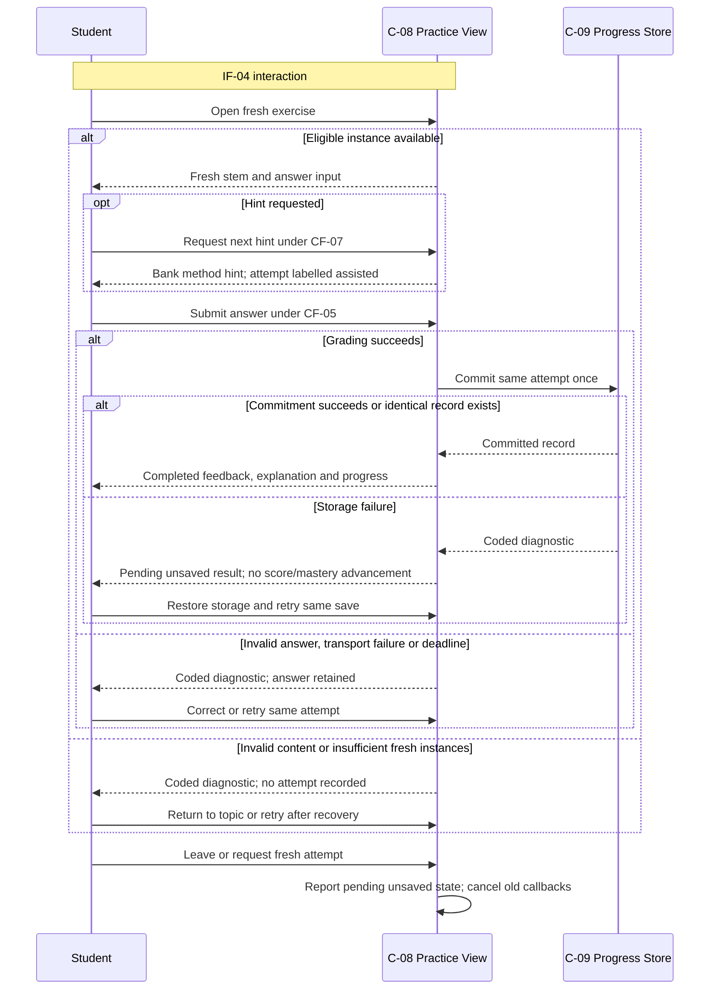

# ADD-0001 — orange First Version (V1) Architecture Baseline

- **Record Path**: `docs/architecture/ADD-0001-orange-v1-baseline.md`
- **Document Type**: Architecture Design Document (ADD)
- **Design Status**: `Draft`
- **Author**: `@zcode` (initial drafting agent); `@codex` (gap-review revision)
- **Architecture Owner**: Repository owner (human) — must self-declare a
  concrete `@<actor-id>` in the approval context before responding `Approve`
- **Required Approver**: Repository owner (human); MUST NOT be the author
- **Approver**: `Pending — approval required`
- **Approval Time**: `Pending — approval required`
- **Approval Evidence**: `Pending — approval required`
- **Approval Context Revision**: None — no immutable revision contains the
  approved content yet (informational and non-binding)
- **Scope Level**: Repository / Cross-project
- **Scope**: Locally deployed orange V1 — C++20 compute service, TypeScript web
  client, and repository-versioned mathematics content (advanced mathematics,
  mathematical analysis, matrix computation)
- **Demand Source**: `AGENTS.md` project statement (repository root); user
  task request on 2026-10-12 (first-version requirements design)
- **Supersedes**: `N/A — first ADD in this architecture root`
- **Superseded By**: `None — not superseded`

This ADD is a non-authorizing solution and planning view. It authorizes no
source, configuration, build, deployment, or operational change. Implementation
requires an Accepted ADR selected from one task candidate in Section 10 under
the ADD-To-ADR handoff contract of `AGENTS.md`.

Conformance note: the shared template
`docs/architecture/template/0000-add-template.md` does not yet exist in this
repository. This document is structured to satisfy the ADD requirements of
`AGENTS.md` directly.

## Requirement Level Legend — `[Required]`

- **`[Required]`**: The section always applies and MUST remain present with
  complete, verifiable content.
- **`[Conditionally Required — <trigger>]`**: The section MUST be completed
  when its stated trigger applies; otherwise it retains `N/A — <reason>`.
- **`[Optional]`**: The section may be removed without affecting acceptance.
  If retained, it MUST be accurate and complete.

## 1. Requirement Baseline — `[Required]`

### 1.1 Captured Demand

| ID | Demand statement | Source |
| --- | --- | --- |
| D-01 | orange is a Web system for studying advanced mathematics, mathematical analysis, matrix computation, physics, and chemistry. | `AGENTS.md` project statement |
| D-02 | orange renders function graphs and provides dynamic interaction with them. | `AGENTS.md` project statement |
| D-03 | The backend is implemented in C++20 and the frontend in TypeScript; developing orange is itself a hands-on study of the C++ and Web technologies it is built with, so the technology boundary is part of the demand, not a free implementation choice. | `AGENTS.md` project statement |
| D-04 | The first version (V1) is the first locally usable increment of the above demand: a single student can run it and study with it on one machine. | User task request, 2026-10-12 |
| D-05 | Within each subject area, knowledge is arranged in an explicit learning order managed as a directed learning-path graph and presented to the student as a flowchart knowledge map; the order is advisory and never gatekeeping. | Repository owner feedback on the ADD-0001 draft, 2026-10-12 |
| D-06 | orange is a personal knowledge-learning tool for one learner on one machine: the product has no user accounts, no authentication or authorization, and no multi-user capability — a permanent product boundary, not a V1 deferral. | Repository owner feedback on the ADD-0001 draft, 2026-10-12 |
| D-07 | The study loop includes practice and assessment: topics carry exercises, the student can self-test, and every answer is recorded incrementally — one question answered, one record written — into a cross-session client-side answer history that drives mastery assessment. | Repository owner feedback on the ADD-0001 draft, 2026-10-12 |
| D-08 | The question bank is the sole runtime content source for exercises, authored in the repository development workflow: AI drafts templates at authoring time, outside the runtime boundary; review is tiered so the single learner is never exposed to content answers before practice — deterministic machine validation is the binding correctness gate (template schema, parameter satisfiability, dry-run synthesis, expected-answer derivability cross-checked by independent numeric computation), AI review is advisory for quality and coverage, and human review is limited to structural metadata (topic coverage, counts, difficulty labels) without content-deep reading. | Repository owner feedback on the ADD-0001 draft, 2026-10-12 |
| D-09 | Practice must resist answer memorization: exercises are authored as parameterized templates, and every attempt presents a freshly drawn instance (new parameter values, reshuffled choice options), so assessment measures mastery of the method rather than recall of specific answers. | Repository owner feedback on the ADD-0001 draft, 2026-10-12 |
| D-10 | Learning progress management covers two dimensions at knowledge-point granularity: what the student has read (content study) and what has been assessed as mastered (exercise performance), both visible on the knowledge map and topic pages, together with per-knowledge-point exercise coverage. | Repository owner feedback on the ADD-0001 draft, 2026-10-12 |
| D-11 | "Learned" is defined deterministically: a knowledge point is mastered when its last three attempts on freshly drawn instances are all correct; any wrong answer resets that point's streak; the state is always recomputable from the append-only answer history. | Repository owner feedback on the ADD-0001 draft, 2026-10-12 |
| D-12 | Exercise coverage includes graphical understanding: choice exercises may carry function-expression options rendered as 2D mini-curves; 3D surface visualization is deferred beyond V1. | Repository owner feedback on the ADD-0001 draft, 2026-10-12 |
| D-13 | Exercise stems, worked explanations, and study content may reference repository-versioned static image assets (geometric figures, physics diagrams, chemistry structures); images referenced by a parameterized template must be parameter-agnostic — they must not embed values that vary per instance. | Repository owner feedback on the ADD-0001 draft, 2026-10-12 |
| D-14 | After grading, the student can tutor interactively with a runtime AI: free-form questions about the completed exercise and escalating hints before answering. The AI endpoint, model, and API key are configured locally by the learner and never enter the repository; when unconfigured or unavailable, tutoring degrades to the exercise's own authored answer and explanation, which remain mandatory bank content; grading and mastery never depend on AI. | Repository owner feedback on the ADD-0001 draft, 2026-10-12 |
| D-15 | orange is deployed only on the learner's local machine; cloud or hosted deployment is outside the product deployment scope. An optional AI provider is not an orange deployment target. | Repository owner clarification after the gap review, 2026-10-12 |
| D-16 | Initial V1 content covers mathematics only: advanced mathematics, mathematical analysis, and matrix computation. Physics and chemistry remain later content scope. | Repository owner clarification after the gap review, 2026-10-12 |
| D-17 | Revise this Draft to close the reviewed gaps in progress attribution, durable recording, historical interpretation, instance freshness, content validation, tutoring disclosure, self-testing, asynchronous recovery, and task boundaries. | Repository owner instruction to apply the gap-review recommendations, 2026-10-12 |

D-01 describes the longer-term subject scope; D-16 narrows the initial release.
Sections 3.1, 3.2, and 4.3 state the concrete Draft choices proposed by this
revision under D-17. They are reviewable design proposals, not quotations of
earlier owner feedback; they become the design baseline only when this ADD is
approved. D-11's three-answer threshold remains fixed; Section 4.3 clarifies
which answers provide independent assessment evidence.

### 1.2 Acceptance-Outcome Baseline

V1 is complete when every statement below is demonstrably true on one
development machine:

- AO-01: Every capability outcome in Section 3 (CAP-01 through CAP-11) is
  observable in the locally running system by a single student.
- AO-02: Every task candidate in Section 10 (TC-0001 through TC-0018) is
  `Complete` via a linked ADR in `Complete` or `Verified` state. Deferring a
  required candidate does not complete V1; removing its outcome requires a
  deliberate revision and approval of this baseline.
- AO-03: No V1 component except the AI tutor requires an account or an
  external network service to deliver the capability outcomes, and no
  component requires a persistent server-side store; when the tutor's
  external service is unconfigured or unavailable, CAP-11 degrades to the
  authored explanation fallback with every other outcome intact.
- AO-04: All six mathematics topics and twelve knowledge points in Section
  3.1 are delivered with their specified reading and exercise coverage; physics
  and chemistry content is not required for V1 acceptance.
- AO-05: The observable scenarios in Section 4.4 are satisfied by the linked
  implementation ADR evidence, including duplicate submissions, failed local
  writes, changed content, unavailable AI, and responses arriving out of order.

Baseline last checked: **2026-10-12**. Later demand changes do not silently
modify this ADD; drift must be reported and this document revised
deliberately, returning it to `Draft` if the change is
approval-invalidating.

## 2. Goals And Non-Goals — `[Required]`

### 2.1 Goals

- G-01: Deliver the V1 acceptance-outcome baseline (Section 1.2).
- G-02: Establish the durable system shape for later versions: web client,
  local compute service, repository-versioned content.
- G-03: Keep every slice small enough to be studied, reviewed, and learned
  from — each task candidate fits one independently reviewable implementation
  pull request.
- G-04: Close the study loop — learn, practice, self-test, and see mastery
  on the knowledge map.

### 2.2 Product Non-Goals (All Versions)

- NG-01: User accounts, authentication, authorization, and multi-user
  capability. orange is a personal study tool for one learner (D-06); these
  are excluded from the product itself, not deferred to a later version.
- NG-12: Cloud or hosted deployment of orange. The application and compute
  service run on the learner's machine (D-15); an optional tutoring provider
  does not host the orange application or its progress store.

### 2.3 Non-Goals (V1)

- NG-02: Server-side persistence (databases, sessions surviving restart).
- NG-03: Container orchestration and remote deployment tooling.
- NG-04: Physics and chemistry content, exercises, and simulations; these
  subjects remain later scope under D-16.
- NG-05: Sharing or export features (collaboration is excluded product-wide
  by NG-01).
- NG-06: Internationalization and mobile-native applications.
- NG-07: Free-form symbolic-answer equivalence grading — V1 grades choice
  and numeric (tolerance) answers only.
- NG-08: Runtime AI question generation — exercise generation, grading,
  and mastery derivation stay offline and deterministic (D-08, D-09,
  INV-14); runtime AI is confined to tutoring dialogue (D-14).
- NG-09: 3D surface visualization (z = f(x, y) rendering with rotation
  interaction) — deferred to a future ADD; V1 renders 2D single-variable
  curves only.
- NG-10: In-product authoring or import UI — question-bank entry happens
  exclusively through the repository authoring workflow (D-08); an in-app
  authoring surface remains a possible future enhancement.
- NG-11: Parameterized figures that vary with instance parameters — V1
  static images are parameter-agnostic only (D-13).

## 3. Functional Capabilities — `[Required]`

| ID | Capability | V1 outcome statement |
| --- | --- | --- |
| CAP-01 | Subject and topic study navigation | The student can browse the three mathematics areas and six topics in Section 3.1; each area presents its knowledge map as a flowchart derived from the area's directed learning-path graph, with recommended next topics and legible notation and optional static figures. Every topic remains freely accessible regardless of order. Physics and chemistry are omitted from V1 navigation rather than presented as usable empty subjects. |
| CAP-02 | Function graph rendering | The student can enter a single-variable expression in a graph workspace and see its curve rendered on a coordinate plane with axes and grid. |
| CAP-03 | Dynamic graph interaction | The student can pan, zoom, and reset the viewport, and edit the expression with live re-rendering of the curve. |
| CAP-04 | Expression validation and diagnostics | Invalid or unsafe input produces a precise, coded, human-readable diagnostic inside the workspace; the system never crashes or hangs from expression input. |
| CAP-05 | Matrix computation playground | The student can define matrices and execute addition, subtraction, multiplication, transpose, determinant, and inverse, seeing either a displayed result or a coded diagnostic (for example, dimension mismatch or singular inverse). |
| CAP-06 | Local single-user runtime | One developer can build and start the backend service and web client locally through one documented path, with no external services required. |
| CAP-07 | Topic exercises | Each required knowledge point carries validated parameterized templates, with typeset stems, optional parameter-independent figures, and worked explanations. A submission receives deterministic grading and a durable per-question record before completed feedback is acknowledged. V1 grades plain choice, 2D graph-choice, and numeric-tolerance answers; freshness and assisted-answer treatment follow Section 4.3. |
| CAP-08 | Self-testing | The student can take a six-question topic self-test under Section 3.2, receive per-question feedback after durable recording, and finish with a score and per-question review. Abandoning or refreshing retains committed answers; the in-progress test itself is not resumed across reloads. |
| CAP-09 | Mastery assessment | Ordered answer history deterministically derives independent three-correct-answer streaks per knowledge-point assessment revision under Section 4.3, then explicit topic rollups. Incorrect answers reset the point's streak; assisted correct answers provide practice evidence without advancing it. Mastery is visible and never gates navigation. |
| CAP-10 | Reading progress | The student explicitly marks individual study units read. Version-bound read events derive knowledge-point and topic read state across sessions under Section 4.3; opening a page does not mark it read. Read, mastered, and exercise-coverage dimensions appear separately on maps and topic pages, with an unavailable state when persistence cannot be read reliably. |
| CAP-11 | AI tutoring with fallback | After completed grading the student can ask free-form questions grounded in that instance and its authored explanation. Before answering, only ordered bank-owned method hints are displayed; AI may select an allowed next hint but arbitrary AI hint text is never displayed. When AI is absent, pre-answer guidance uses those same hints and post-answer review uses the authored explanation. Neither grading nor mastery depends on AI. |

### 3.1 Initial Mathematics Content Coverage — `[Required]`

Each listed topic has exactly the two assessable knowledge points named below
for the initial baseline. A complete topic includes notation and definitions,
the stated rule and its conditions, at least one worked example and one common
error per knowledge point, and at least one explicitly mapped study unit per
point. Each point has at least two parameterized templates, each permitting at
least three distinct valid problem instances and carrying a worked explanation
and at least two ordered method hints. Each point has at least five distinct
problem fingerprints across its templates, leaving three candidates after
excluding two recent assessment variants. The initial bank therefore contains
at least 24 templates. Choice and numeric kinds are both represented in each
area; the two marked graph topics each include at least one graph-choice
template. Graph-choice may count toward that topic's template minimum.

| Coverage ID | Mathematics area | Initial topic | Assessable knowledge points | Recommended order | Exercise emphasis |
| --- | --- | --- | --- | --- | --- |
| MC-01 | Advanced mathematics | Functions and elementary derivatives | Elementary derivative rules; chain rule | Before MC-02 | Choice and numeric derivative values |
| MC-02 | Advanced mathematics | Derivatives and function behavior | Monotonicity from derivative sign; stationary points and extrema | After MC-01; final node has no next recommendation | Numeric extrema and graph-choice behavior |
| MC-03 | Mathematical analysis | Sequence limits | Limits of elementary sequences; limit arithmetic and its conditions | Before MC-04 | Choice conditions and numeric limits |
| MC-04 | Mathematical analysis | Function limits and continuity | One-sided limits; continuity at a point | After MC-03; final node has no next recommendation | Numeric limits and graph-choice continuity |
| MC-05 | Matrix computation | Matrix operations | Dimension compatibility and entrywise operations; matrix multiplication and transpose | Before MC-06 | Choice dimensions and numeric entries |
| MC-06 | Matrix computation | Determinants and inverse matrices | Determinant and singularity; inverse existence and selected inverse entries | After MC-05; final node has no next recommendation | Choice invertibility and numeric determinant or inverse entries |

All twelve points have exercise coverage. Later or diagnostic content with no
validated templates shows `no exercise coverage`, has no mastery claim, and
cannot start a self-test. Coverage counts templates and available kinds, not
the number of times the learner has attempted them. These topics are an entry
baseline, not a claim to cover the full mathematics curriculum.

### 3.2 Self-Test Rules — `[Required]`

- ST-01: A test covers one current topic and its two knowledge points. It has
  six questions, three per point, interleaved in the topic's declared point
  order. Template selection rotates through the point's validated templates;
  a template may repeat with a distinct problem instance. The initial selection
  is seeded and reproducible, and freshness follows Section 4.3.
- ST-02: Before presenting the first question, every scheduled instance must
  be valid and satisfy freshness. No coverage, insufficient valid instances,
  content rejection, or storage unavailability prevents starting the test with
  a coded diagnostic; no empty test or misleading zero score is produced.
- ST-03: A question accepts one committed answer. Duplicate submission retries
  that same attempt; changing an answer after commitment requires a fresh
  practice attempt outside the test. Invalid input, transport failure, and
  storage failure do not count as incorrect answers or advance the question.
- ST-04: Skipping or finishing early marks remaining questions unanswered for
  that test. Unanswered questions score zero but create no AnswerRecord and
  have no effect on mastery. Only committed correct answers score one point;
  the displayed result is `correct count / 6` and the corresponding percentage.
  Assistance does not change the score, but is shown in review and affects
  mastery as specified in Section 4.3.
- ST-05: Feedback and authored explanations appear after each committed
  answer. Final review distinguishes correct, incorrect, and unanswered items,
  preserves the presented instance and option order, and labels assistance.
  The test is a practice-oriented self-test, not a closed-book examination.
- ST-06: Abandon, refresh, or close terminates the volatile TestSession; already
  committed answers remain. No final score is fabricated for an interrupted
  test, and a new test uses new attempts. A pending storage write must report
  that the question is not yet saved before an ordinary leave action completes;
  forced browser termination may lose an unacknowledged attempt.

## 4. Conceptual Data Model — `[Required]`

### 4.1 Entities

These are conceptual attributes and relationships, not executable schemas.
Exact serialization and implementation contracts belong to the selected ADR.

| Entity | Purpose | Conceptual attributes | Volatility |
| --- | --- | --- | --- |
| SubjectArea | One subject in the product catalog | Stable identity, name, description, release inclusion | Repository-versioned, read-only |
| LearningPathGraph | Advisory learning order for one included area | Area, directed edges between topics | Repository-versioned, read-only |
| Topic | One study topic | Stable identity and revision, area, title, ordered units and knowledge points | Repository-versioned, read-only |
| KnowledgePoint | One assessable learning outcome | Stable identity, assessment revision, topic, statement and conditions, mapped required study units | Repository-versioned, read-only |
| StudyUnit | One content block | Stable identity and content revision, kind, notation-bearing body, knowledge-point mappings, optional assets | Repository-versioned, read-only |
| ContentAsset | Static content illustration | Identity and revision, format (SVG or PNG), size, references, parameter-independence provenance for exercise use | Repository-versioned, read-only |
| ExerciseTemplate | Parameterized practice content | Identity and immutable revision, exactly one primary assessed knowledge point and its assessment revision, optional related points, finite parameter domain and constraints, stem, plain or graphical options, answer derivation, numeric tolerance, worked explanation and ordered method hints, optional eligible assets | Repository-versioned, read-only |
| ExerciseInstance | One attempted problem | Attempt identity, immutable template and synthesis-rule revisions, seed, parameters, materialized problem, problem fingerprint, option identities and presentation order, derived answer | Volatile until the graded snapshot is committed |
| GraphWorkspaceState | Current graph session | Expression, variable, viewport, current request generation, displayed-result viewport | Browser session, volatile |
| EvaluationRequest / EvaluationResult | Sample a function or report rejection | Expression, domain, resolution; ordered samples with gap markers or coded diagnostic | Transient |
| MatrixSheetState | Current matrix session | Named matrices, dimensions, finite entries, current request generation | Browser session, volatile |
| MatrixOperationRequest / MatrixOperationResult | Invoke an operation or report rejection | Operation and operands; result matrix or scalar, or coded diagnostic | Transient |
| AnswerRecord | One durably committed answer | Attempt identity, local commit order, timestamp for display, template and synthesis revisions, primary point and assessment revision, seed and parameters, presented problem and option-order snapshot, submitted answer, recorded correctness, authored explanation snapshot, assistance flag, freshness evidence | Client-side persistent, append-only |
| ReadEvent | One explicit read confirmation | Event identity, local commit order, unit identity and content revision, mapped knowledge points, timestamp for display | Client-side persistent, append-only |
| TestSession | One self-test | Session identity, topic revision, six ordered instances, committed attempt references, unanswered states, score on finish | Browser session, volatile; answers persist independently |
| KnowledgePointMastery | Independent assessment evidence | Point and assessment revision, qualifying streak, state (unpracticed, practicing, mastered), total and assisted attempt counts | Derived from ordered AnswerRecord history |
| TopicProgress | Separate topic summaries | Per-point read and mastery states, read and mastered counts, template coverage, storage-health state | Derived; never separately editable |
| TutorConfig | Local provider settings | Endpoint, supported protocol, model, API key | Client-side persistent settings; replaceable, never versioned in the repository |
| TutorConversation | Dialogue about exactly one instance | Attempt identity, pre-answer or post-answer mode, ordered turns, active request generation | Browser session, volatile |
| ContentValidationEvidence | Eligibility of one content revision | Validated revisions, coverage and reference outcomes, valid-instance counts, independent answer verification, option uniqueness and figure provenance outcomes | Repository authoring evidence; read-only at runtime |

### 4.2 Invariants

- INV-01: Expression evaluation and matrix computation are pure and
  deterministic for a fixed declared computation revision: identical requests
  yield identical results and cause no filesystem, network, or other effects.
- INV-02: Expressions use a safe single-variable numeric grammar; anything
  outside it is rejected with a coded diagnostic and never executed.
- INV-03: Content is repository-versioned and read-only at runtime. Runtime
  server-side persistence is absent. Persistent learner state consists of
  local append-only answer records and read events, plus replaceable local
  tutor settings; derived progress and test or tutor sessions are not separate
  persistent truth.
- INV-04: No learner identity, account, role, permission, or cross-user session
  exists. Origin and input checks are transport protection, not user accounts.
- INV-05: Matrix dimensions and finite values are validated before computation;
  incompatible or mathematically undefined results produce diagnostics.
- INV-06: Sampling domain failures produce gaps. Renderers never connect across
  a known discontinuity; if continuity cannot be established for an interval,
  that interval is shown as a gap rather than an invented connecting segment.
- INV-07: Each included area's learning graph is directed, acyclic, contains
  every included topic, and has no dangling references. Invalid graphs fail
  content validation and never produce a partially accepted map.
- INV-08: Learning order, read state, and mastery are advisory and never block
  access to any topic or workspace.
- INV-09: Each completed question is committed exactly once before completed
  feedback, score changes, or mastery changes are acknowledged. Records are
  incremental, not delayed to test end. Same-attempt retries reuse the existing
  commitment; conflicting payloads for an already committed attempt are
  rejected. A new answer requires a new attempt. Study flows never edit or
  delete existing records.
- INV-10: Grading is deterministic against the immutable bank template and
  instance revisions. Client-supplied expected answers are never authoritative.
- INV-11: Identical template revision, synthesis-rule revision, and seed yield
  the same parameters, problem, answer, and option order. A seed alone does
  not assert freshness; Section 4.3 governs freshness and bounded redrawing.
- INV-12: The mastery threshold is exactly three independent correct
  assessments, with no template, topic, or settings override. The ordered
  reduction in Section 4.3 is the sole mastery authority.
- INV-13: Read state comes only from explicit, committed, version-bound read
  events and their declared unit mappings. Page loading is not a read event.
- INV-14: Synthesis, grading, progress, and authored hints work without AI.
  Post-answer fallback exposes the authored explanation; pre-answer fallback
  exposes only the next allowed method hint, never the answer or explanation.
- INV-15: Pre-answer tutoring excludes expected answers, correctness labels,
  worked explanations, answer derivations, prior-instance conversations, and
  progress history from its context. It may display only an allowed bank-owned
  hint in order; unrecognized or arbitrary AI hint output is rejected before
  display. Post-answer context concerns only the completed current instance.
- INV-16: Every committed event has a stable identity and one serialized local
  commit order, including submissions from multiple tabs. Timestamps are
  display metadata, not ordering authority. Existing events retain their
  recorded correctness and point attribution after content updates.
- INV-17: Only currently validated bank revisions supply runtime exercises.
  Synthesis and grading resolve authoritative bank content, not arbitrary
  templates received from the browser. Validation failure prevents publication
  of that content revision to the runtime bank.
- INV-18: Superseded, timed-out, or cancelled requests cannot replace a current
  view, reveal an old instance's answer, or initiate a new commitment from an
  inactive callback. A commitment dispatched while the attempt was active may
  finish after navigation; its record remains, but no obsolete view reopens.

Before grading, the learner-facing instance projection excludes the expected
answer, answer derivation, and worked explanation; these remain authoritative
Exercise Engine content. A grading response may carry the authored explanation
for the pending snapshot, but completed feedback reveals it only after the
local commitment succeeds. This is an ordinary learner-flow disclosure rule,
not an account or anti-tampering mechanism against the owner of the machine.

### 4.3 Progress, Freshness, And Lifecycle Rules — `[Required]`

| Rule ID | Design rule |
| --- | --- |
| PR-01 | A unit becomes read only when the learner invokes its explicit read-confirmation action and its event is durably committed. A point is read when every current required unit mapped to it is read at that unit's current content revision. A topic is read when all its points are read. Reconfirming the same unit revision is idempotent. |
| PR-02 | A template assesses exactly one primary point. Optional related-point references explain connections but never award additional mastery. Study units may map to several points. Points with no exercise coverage show that condition separately and never become mastered from another point's answers. |
| PR-03 | Reduce committed records in local commit order for each current point assessment revision: any incorrect answer resets the streak to zero; a correct, fresh, unassisted answer increments it; a correct assisted or non-fresh answer leaves it unchanged and is labelled practice evidence. An answer is assisted once any pre-answer hint is displayed; closing the hint view does not clear that flag. Three independent correct assessments since the last incorrect answer yield mastered; an incorrect assisted answer also resets mastery. |
| PR-04 | A point with no committed attempts is unpracticed; one with attempts but fewer than three qualifying correct assessments is practicing. A topic is mastered only if all its current points are mastered; otherwise it is unpracticed if every point is unpracticed, or practicing. Show mastered-count / point-count and read-count / point-count separately; one dimension never implies the other. |
| PR-05 | V1 graded templates have non-empty parameter domains. Static questions remain worked study examples and cannot supply graded practice or mastery. A new instance must change the materialized problem, not merely its seed or option order. For its primary point it must differ from the last two independently assessed problem fingerprints at that assessment revision and from every instance already scheduled in the same test. C-09 rechecks current history at commitment; a concurrent duplicate variant remains a recorded practice answer, labelled non-fresh, and never advances mastery. |
| PR-06 | Choice options retain stable semantic identities across shuffling; grading does not confuse a displayed position with an original index. Each fresh choice attempt reshuffles options; the same permutation may recur, but shuffling alone never establishes a fresh problem. Redrawing terminates after at most 32 candidate seeds with a coded insufficient-instance diagnostic rather than an unbounded loop. |
| PR-07 | Each answer retains an immutable graded snapshot and recorded point attribution. A template update creates a new revision; a changed learning outcome, answer-key correction, or invalidated grading rule creates a new assessment revision for the affected point. Earlier assessment revisions remain historical evidence and do not count toward the new assessment revision. Removing a template does not erase its committed answers or reinterpret their correctness. Presentation-only corrections do not change assessment revision. |
| PR-08 | A changed study-unit content revision requires a new read confirmation for current read state; old read events remain historical. Unit or point reference removal never silently reassigns an old event to a new point. |
| PR-09 | Grading success followed by storage failure leaves the attempt pending and retains its answer and graded result in the active view for a save retry. It neither acknowledges completion nor advances score or mastery. Save retries keep the same attempt identity and immutable snapshot. A forced reload before acknowledgment may discard a pending attempt; it must not be reported as saved. |
| PR-10 | Storage unavailable, quota exceeded, or integrity failure shows a coded progress-unavailable state; it never silently replaces history with an empty store or skips damaged records to claim mastery. Reading content and using compute workspaces remain possible, but new assessed submissions and read confirmations require healthy storage. Recovery re-reads and validates the existing store before a pending save is retried. |
| PR-11 | Browser-origin data clearing, private browsing, a different browser profile, or an origin change may remove access to local history. V1 has no export, import, backup, or cross-profile synchronization. Lost external browser data is unrecoverable by orange; affected progress is unpracticed only after a positively established empty store. Local deployment preserves its documented browser origin across ordinary restarts. |
| PR-12 | Tutoring conversations are bound to one attempt. Moving to a new instance starts an isolated conversation and hint sequence. Hints never transition automatically to an answer after exhaustion. Completed-instance answers cannot enter the next instance's pre-answer context. |

The assessment fingerprint window contains the last two fresh, unassisted
committed attempts, whether correct or incorrect. A concurrent non-fresh
correct answer, like a correct assisted answer, remains practice evidence
without advancing the streak. Incorrect answers always reset it. Repeating a
variant outside this two-attempt window is allowed: freshness is a bounded
anti-repetition rule, not a promise of globally unique questions forever.

### 4.4 Observable Gap-Closure Outcomes — `[Required]`

These are solution-level outcome examples. Detailed executable acceptance
checks and their evidence are owned by the selected implementation ADRs.

| Outcome ID | Preconditions and action | Exact observable outcome | Candidate owners |
| --- | --- | --- | --- |
| GO-01 | One unit maps to two points; explicitly confirm it read, then open another unconfirmed unit required by one of those points | Only the point whose entire required-unit set is confirmed is read; opening the other unit adds no event | TC-0006, TC-0014 |
| GO-02 | Submit one attempt twice, including from two tabs; then retry a failed save after grading | At most one committed record exists for the attempt; completion appears only after commitment; retries do not add streak increments | TC-0006, TC-0015 |
| GO-03 | An unassisted fresh correct sequence has length three; then submit a wrong assisted answer | The point first becomes mastered, then practicing with streak zero; a correct assisted answer alone never increments the streak | TC-0006, TC-0014 |
| GO-04 | Update or remove an attempted template, change one point's assessment revision, and update a confirmed study unit | Old answer snapshots remain interpretable; old assessment evidence does not award new-revision mastery; the changed unit is not currently read | TC-0002, TC-0006, TC-0014 |
| GO-05 | Present duplicate problem variants or only changed option orders, then exhaust 32 redraw candidates | Duplicates do not become fresh attempts; exhaustion produces a coded diagnostic and no answer record | TC-0006, TC-0009, TC-0015 |
| GO-06 | Validate a bank containing inconsistent stem/answer conditions, two correct choice options, indistinguishable graph options, or unverifiable exercise-asset provenance | The affected content revision is rejected before runtime publication; diagnostics identify the failing template or asset without revealing answers in metadata-only reports | TC-0016 |
| GO-07 | Request a pre-answer hint with AI absent or returning free-form answer text; then request post-answer help after committed grading | Before answering only the next bank-owned method hint is displayed; rejected AI output is not displayed; after commitment the authored explanation is available | TC-0011, TC-0017 |
| GO-08 | Finish a six-question test with four correct, one incorrect, and one unanswered; abandon another after two committed answers | The finished score is 4/6; the unanswered item creates no answer event; the abandoned test retains exactly its two committed attempts and has no final score | TC-0008 |
| GO-09 | Request graph A then B and receive B then A; close a tutor or clear a workspace before its response arrives | B remains current; late responses do not reopen closed views or repaint a cleared workspace; a timed-out request ends the loading state | TC-0004, TC-0013, TC-0017 |
| GO-10 | Make local storage unavailable or corrupt, then restore valid storage | Progress is unavailable rather than falsely empty; assessed commits are blocked; recovery validates the old history before deriving progress or retrying a save | TC-0006, TC-0014, TC-0015 |

## 5. Architecture Design — `[Required]`

### 5.1 Component Table

| Component ID | Component | Responsibility | Implementation boundary | Technology constraint |
| --- | --- | --- | --- | --- |
| C-01 | Web Client Shell | Mathematics navigation, learning-graph validation and map rendering, topic and notation rendering, explicit read actions, separate read/mastery/coverage overlays and storage-health feedback | Presentation / framework delivery | TypeScript, local browser |
| C-02 | Graph Workspace | Expression and viewport editing, curve rendering, request ordering and cancellation, coded diagnostics and correctly labelled prior results | Presentation | TypeScript, browser |
| C-03 | Matrix Playground | Matrix editing, operation requests, result reuse, request lifecycle and diagnostics | Presentation | TypeScript, browser |
| C-04 | Compute API | HTTP delivery of evaluation, matrix, synthesis and grading; input and origin validation, resource and deadline enforcement; delegation of domain policy | Provider / transport integration | C++20, loopback-only service |
| C-05 | Expression Evaluation Engine | Safe parsing, single-variable evaluation, bounded sampling and discontinuity gaps | Domain / application policy | C++20 |
| C-06 | Matrix Computation Engine | Pure matrix operations, dimension/value checks and numerical failure diagnostics | Domain / application policy | C++20 |
| C-07 | Study Content Store | Immutable content and template revisions, learning/unit/point mappings, validated runtime eligibility and static assets | Persistence / data behavior | Repository-versioned content |
| C-08 | Practice And Self-Test View | Instance materialization, stable option rendering, single-attempt capture, commit-before-feedback orchestration, assisted-answer labels, self-test assembly/scoring/review | Presentation | TypeScript, browser |
| C-09 | Progress Store | Serialized idempotent answer/read commitments across tabs, integrity checks and storage errors, revision-aware independent mastery and read reduction | Persistence / data behavior | Browser-local storage |
| C-10 | AI Tutor Client | Local provider settings, permitted context assembly, bound conversation and hint modes, provider calls and response rejection, authored-hint/explanation fallback, request lifecycle | Provider / transport integration | TypeScript, browser |
| C-11 | Exercise Engine | Authoritative bank resolution, seeded bounded synthesis and freshness checks, answer derivation and deterministic grading, stable choice identities | Domain / application policy | C++20 |
| C-12 | Content Validator | Authoring-time coverage and reference checks, exhaustive finite-domain eligibility, independent correctness checks, option distinguishability, hint/asset provenance and metadata-only report | Authoring provider / tool integration | Repository development workflow, outside runtime |

### 5.2 Architecture Diagram

The two orange runtime boundaries are the local browser and loopback C++20
service. C-12 belongs to the repository authoring workflow, not the running
application. Content delivery details are delegated to TC-0002, but both the
client and Exercise Engine resolve the same validated immutable revisions.
Only the optional browser AI client calls the learner-configured provider;
this does not constitute cloud deployment of orange. Human review sees
structural metadata only, and AI content review is advisory.

## 6. Control Flow Design — `[Conditionally Required — V1 defines CF-01 through CF-08]`

The trigger applies: seven runtime flows and one authoring eligibility flow
are specified. Tables and diagrams represent each flow ID. Deadlines, latest
request ownership, and cancelled-response rejection apply to all runtime
flows under CON-12; persistence outcomes additionally follow Section 4.3.

### 6.1 Flow Table

| Flow ID | Flow | Ordered steps | Branches and failure termination | Recovery |
| --- | --- | --- | --- | --- |
| CF-01 | Expression evaluation | Edit expression; C-02 issues current request; C-04 validates; C-05 samples; C-02 accepts current result and renders | Grammar/resource rejection or timeout yields diagnostic; domain errors yield gaps; superseded or cancelled responses are ignored | Edit retries; clear/navigation cancels; last result remains labelled with its own expression and viewport |
| CF-02 | Viewport re-render | Pan/zoom/reset; C-02 updates viewport and request ownership; C-04 samples; current response replaces curve | Transport error or deadline retains a clearly labelled prior result, not a curve falsely relabelled to the new viewport; old responses are ignored | Next gesture retries; reset restores default viewport and requests fresh samples |
| CF-03 | Matrix operation | Edit operands; invoke; C-04 validates; C-06 computes; current result is displayed and may become an operand | Invalid dimensions, non-finite values, singularity or numerical failure produces diagnostic; transport/deadline failure retains inputs; cancelled results are ignored | Correct and retry; clear/navigation cancels |
| CF-04 | Topic and progress load/read | Load validated area graph; derive current progress from C-09; render map; open topic; learner explicitly confirms a unit; C-09 commits event; C-01 refreshes overlays | Missing/invalid content blocks the affected view; storage failure shows unavailable progress but permits reading; cancelled loads do not repaint | Return to subject; restore valid storage and retry explicit confirmation |
| CF-05 | Exercise and durable answer | Resolve validated template; C-11 synthesizes a fresh instance; C-08 renders; optional safe hint marks assistance; validate submission; C-11 grades; C-09 idempotently commits; C-08 acknowledges feedback and progress | Invalid synthesis/answer or transport failure creates no record; storage failure leaves graded answer pending; duplicate commitment returns existing record; conflicting resubmission is rejected; cancellation blocks new save dispatch from obsolete callbacks but retains already dispatched commitments | Retry same grading attempt or same pending save; new answers require a fresh attempt |
| CF-06 | Self-test | Verify coverage/storage; assemble six fresh instances under ST-01; execute CF-05 for each answered item; skip/finish marks unanswered items; score committed outcomes and review | Insufficient coverage/instances prevents start; CF-05 failures do not advance; abandon/refresh retains commits and terminates session without a final score | Resolve prerequisite error or start a new test |
| CF-07 | Hint or post-answer tutor | Isolate current attempt/mode; collect only permitted context; use configured provider when compatible; validate hint selection or display post-answer response | Pre-answer arbitrary output is rejected; unconfigured/error/timeout uses next authored method hint before answer, or authored explanation after commitment; no hints remaining shows exhausted state; closing view rejects late output | Retry within same mode or continue with bank-owned guidance; new instance starts new context |
| CF-08 | Content eligibility | AI-assisted draft; C-12 checks coverage, references, finite domain, independent correctness, options, hints and assets; issue answer-free metadata report; publish only passed immutable revisions to C-07 | Failed check blocks the affected revision and dependent coverage; unchecked content never becomes runtime eligible; authoring-limit exhaustion is a validation failure | Revise draft, revalidate, retain last passed bank revision until replacement passes |

### 6.2 Flow Diagrams

CF-01 and CF-02 — Expression and viewport requests:

CF-03 — Matrix operation:

CF-04 — Topic, explicit reading, and progress:

CF-05 — Exercise, grading, and durable recording:

CF-06 — Self-test:

CF-07 — Mode-specific tutoring:

CF-08 — Authoring eligibility:

## 7. Interaction Flow Design — `[Conditionally Required — V1 defines IF-01 through IF-06]`

The trigger applies. Each interaction has a table row and a sequence diagram
showing feedback, cancellation, failure, and recovery. CF-01 through CF-07
supply the corresponding system behavior.

### 7.1 Interaction Table

| Interaction ID | Interaction | Learner actions | Feedback | Cancellation | Failure and recovery |
| --- | --- | --- | --- | --- | --- |
| IF-01 | Study along the mathematics map | Browse three areas; freely open a topic; explicitly confirm individual units read; open a workspace | Six-topic baseline, separate read/mastery/coverage indicators, version-aware read confirmation and next topics | Navigate away; ignore obsolete loads | Content diagnostic returns to subject; storage-unavailable notice allows reading and retry after restoration |
| IF-02 | Explore a function | Edit expression, pan, zoom, reset | Current curve with axes/grid/gaps or coded error; prior curve labelled with its original context | Clear or navigate away | Correct input or retry after timeout; old results never override current input |
| IF-03 | Compute with matrices | Define matrices; choose operation; reuse matrix result | Finite result or coded diagnostic; inputs retained on failure | Clear or navigate away | Correct operands or retry; cancelled responses do not restore cleared data |
| IF-04 | Practice one instance | Open exercise; optionally request ordered hints; submit once; retry pending save; start fresh attempt | Fresh problem, assistance label, completed feedback and explanation only after commitment | Leave; unsaved attempt notice; existing commits retained | Synthesis/grading failures retain answer; storage failure labels pending state and retries the same commitment |
| IF-05 | Self-test and review | Start six-question topic test; answer/skip; finish or abandon | Progress, per-question committed feedback, score out of six and correct/incorrect/unanswered review | Abandon/refresh ends session without a final score | Prerequisite error prevents start; answer/save failure stays on same question; new test after recovery |
| IF-06 | Configure and use tutor | Set local endpoint/model/key; request method hints before answering or free-form help after completed grading | Compatible configuration status, ordered authored hints or current-instance dialogue, mode-specific fallback | Close tutor; new instance isolates conversation | Unsupported protocol, unavailable provider, rejected hint selection, or deadline shows coded notice and safe fallback; edit settings or retry |

### 7.2 Interaction Diagrams

IF-01 — Study and explicit read confirmation:

IF-02 — Graph exploration:

IF-03 — Matrix computation:

IF-04 — Practice and recording:

IF-05 — Six-question self-test:

IF-06 — Tutor settings and disclosure modes:

## 8. Cross-Cutting Constraints — `[Required]`

| ID | Constraint |
| --- | --- |
| CON-01 | Backend C++20 and frontend TypeScript remain fixed by D-03. Frameworks, libraries and provider protocols are ADR decisions within the approved boundaries. |
| CON-02 | orange runs only on the learner's machine. The compute service is loopback-only, has no outbound runtime calls, and exposes no LAN or cloud deployment mode. The optional learner-configured AI provider does not host orange or its progress data. |
| CON-03 | Computation, synthesis and grading are deterministic for their declared immutable revisions; replay includes revision identity, not seed alone. |
| CON-04 | Local service response budgets are p95 at most 200 ms for evaluation at the 1000-sample default and for each matrix operation through 50 x 50, and at most 100 ms for grading and synthesis. The runtime ADR records its reference local hardware/OS/toolchain; performance evidence uses 20 warm-ups and 100 serial requests per declared workload, nearest-rank p95, with request fixtures and measurement scope recorded. This does not promise the same latency on unspecified hardware. |
| CON-05 | Trust-boundary limits: expression and answer payloads at most 1000 characters; at most 5000 samples; finite domain endpoints; matrix operands at most 50 x 50 with finite entries. Parser complexity, concurrent work and provider response bounds receive explicit finite limits in their ADRs; exceeding a limit returns a coded diagnostic. |
| CON-06 | Support the two most recent major versions of Chrome, Firefox, Safari and Edge on desktop at the implementation acceptance date. Record tested browser/OS versions; compatibility does not imply shared storage across profiles or browsers. |
| CON-07 | Every user-visible failure has a deterministic code and readable text; messages and metadata-only reports contain no credentials or hidden correct answers. |
| CON-08 | Navigation, read confirmation, graph and matrix entry, answers, self-tests, and tutoring controls are keyboard-operable. Progress, selection, curve options, and errors have text descriptions and never rely only on color. |
| CON-09 | Tutor endpoint, model and API key are learner-local settings; keys never enter repository content, diagnostics, logs or answer snapshots. Configure only explicitly supported provider protocols and destinations; missing browser compatibility yields a coded unavailable state with authored fallback, not a new backend proxy boundary. |
| CON-10 | Static SVG/PNG assets are at most 500 KB and have validated references, formats and safe rendering. Parameterized exercises accept only assets whose parameter independence is mechanically verifiable from restricted source/provenance; a declaration or advisory visual review alone is insufficient. Unverifiable assets, including opaque raster figures, may be used in study content but not parameterized exercise templates. Human review remains structural metadata only. |
| CON-11 | Outbound tutor context is an explicit allowlist for one current instance: stem/options, permitted point descriptions, current learner questions, and, only after commitment, that instance's submitted answer, correctness and explanation. Whole progress records, read history, unrelated attempts, and API keys in the body are excluded. The key authenticates only calls to the configured destination; redirects cannot forward credentials to another destination. |
| CON-12 | Client compute requests terminate loading after 2 seconds; tutor requests after 30 seconds. Only the latest active graph/viewport or matrix request may repaint its view. Closing, clearing, changing instance or changing tutor mode invalidates prior callbacks; retries are learner initiated and preserve the appropriate attempt identity. No unbounded automatic retries. Server-side deadlines and overload rejection must fit inside the client compute deadline. |
| CON-13 | Numeric inputs accept finite decimal or scientific-notation scalars; symbolic expressions, non-finite values and unit-bearing strings are rejected. Each numeric template declares non-negative finite absolute/relative tolerances and a finite expected value; acceptance uses absolute error at most the larger of absolute tolerance and relative tolerance times the absolute expected value, inclusively. Zero-valued expectations require an explicit absolute tolerance. Choice answers use stable option identity. Matrix ill-conditioning, overflow and graph discontinuity handling require explicit diagnostics or gaps rather than misleading finite-looking output. |
| CON-14 | V1 templates use finite parameter domains with at most 1000 candidate tuples per template. Binding validation examines the entire domain, checks constraints, at least three distinct valid problems per template and five per point, independently verifies each valid instance against structured stem conditions, checks unique choice correctness and distinguishable graph options in their declared display window, and rejects unchecked or unsupported semantics. The independent verifier must not reuse the runtime expected-answer derivation as its oracle. |
| CON-15 | Method hints contain ordered abstract methods or rule references, not substituted final values, correct-option identities or worked-solution steps. Pre-answer display is restricted to this validated content; arbitrary AI prose cannot satisfy the no-answer-reveal contract. Numerical worked steps are checked against the structured problem; pedagogical prose quality is reviewed by advisory AI. Machine validation does not prove every natural-language explanation's educational correctness; that residual limitation is explicitly part of this Draft baseline. |
| CON-16 | Validate local API origins and all inputs independently of the no-account product boundary. Content and AI output render as constrained inert content; scripts, active SVG behavior and untrusted HTML cannot execute. Exact transport/rendering safeguards belong to the corresponding ADRs. |

## 9. Traceability — `[Required]`

| Demand | Capabilities / design outcomes | Components | Task candidates |
| --- | --- | --- | --- |
| D-01, D-16 (initial mathematics; later physics/chemistry) | CAP-01, MC-01 through MC-06 | C-01, C-07, C-12 | TC-0002, TC-0012, TC-0016, TC-0018 |
| D-02 (graphs and interaction) | CAP-02 through CAP-04, GO-09 | C-02, C-04, C-05 | TC-0003, TC-0004 |
| D-01 (matrix study) | CAP-05, MC-05, MC-06 | C-03, C-04, C-06, C-07 | TC-0005, TC-0013, TC-0018 |
| D-03, D-04, D-15 (technology and local-only deployment) | CAP-06, AO-03 | C-01, C-04, C-07 | TC-0001 |
| D-05 (advisory learning map) | CAP-01, CAP-09, CAP-10 | C-01, C-07, C-09 | TC-0002, TC-0012, TC-0014, TC-0018 |
| D-06 (personal tool without accounts) | CAP-06, INV-04, CON-02 | C-01, C-04, C-09, C-10 | TC-0001, TC-0006, TC-0011 |
| D-07 (practice, tests, incremental history) | CAP-07 through CAP-09, ST-01 through ST-06, GO-02, GO-08 | C-04, C-08, C-09, C-11 | TC-0006, TC-0007, TC-0008, TC-0009, TC-0015 |
| D-08 (repository bank and no-exposure review) | INV-17, CF-08, GO-06 | C-07, C-11, C-12 | TC-0002, TC-0016, TC-0018 |
| D-09 (fresh parameterized practice) | CAP-07, CAP-08, PR-05, PR-06, GO-05 | C-08, C-09, C-11, C-12 | TC-0006, TC-0009, TC-0015, TC-0016 |
| D-10 (point-level read/mastery/coverage) | CAP-09, CAP-10, PR-01 through PR-04, GO-01 | C-01, C-07, C-09 | TC-0002, TC-0006, TC-0014, TC-0018 |
| D-11 (fixed three-correct independent assessment) | INV-12, PR-03, GO-03 | C-09 | TC-0006, TC-0014 |
| D-12 (2D graph-choice) | CAP-07, MC-02, MC-04 | C-04, C-05, C-08, C-12 | TC-0003, TC-0010, TC-0016, TC-0018 |
| D-13 (static parameter-independent figures) | CAP-01, CAP-07, CON-10, GO-06 | C-01, C-07, C-08, C-12 | TC-0002, TC-0012, TC-0015, TC-0016, TC-0018 |
| D-14 (optional tutor and safe fallback) | CAP-11, CF-07, IF-06, GO-07 | C-08, C-10 | TC-0011, TC-0017 |
| D-17 (gap closure) | AO-05, GO-01 through GO-10, PR-01 through PR-12, CON-12 through CON-16 | C-01 through C-12 as applicable above | TC-0002 through TC-0018 as applicable above |

## 10. ADR Task Candidates — `[Required]`

Every candidate is `Ready` as a Draft proposal, and becomes eligible for
selection only once this ADD is `Current`. Each row owns one complete outcome,
one primary implementation boundary, and one implementation pull request.
Supporting interfaces are limited to the named outcome. No row authorizes
implementation, a governed build, or deployment. The exact repository-relative
ADR path remains unassigned until reciprocal selection is made atomically.

Existing TC identifiers are retained with narrowed outcomes. Navigation,
matrix presentation, progress presentation, practice presentation, validation,
tutoring presentation, and initial content now have independent candidates,
so backend or storage work does not conceal separately mergeable deliverables.

| ID | Complete outcome and scope boundary | Primary implementation boundary | Dependencies | Acceptance context | Recommended ADR type | Status | ADR path |
| --- | --- | --- | --- | --- | --- | --- | --- |
| TC-0001 | One documented local runtime path serves the TypeScript client and loopback C++20 health endpoint through a stable browser origin; no domain features or remote deployment tooling | Runtime assembly | None | Clean local checkout starts both sides, client reaches health endpoint, and ordinary restart preserves the origin; no LAN listener | Full ADR | Ready | None — not yet selected |
| TC-0002 | A versioned content contract represents topic/unit/point mappings, immutable template revisions, stable options, hints, assets and validation eligibility; no learner UI or validation-tool implementation | Persistence / data behavior (repository content) | TC-0001 | Content fixtures represent every declared entity and revision relationship without dangling identifiers; historical revisions retain interpretable identity | Full ADR | Ready | None — not yet selected |
| TC-0003 | Safe bounded evaluation returns samples/gaps or coded diagnostics through the required minimal API interface; backend evaluation only | Domain / application policy (backend evaluation) | TC-0001 | Identical revision-bound requests match, invalid/oversized expressions are rejected, and known discontinuities never yield a connecting segment | Full ADR | Ready | None — not yet selected |
| TC-0004 | Interactive graph workspace renders current samples and axes/grid, supports pan/zoom/reset/edit, and handles deadlines and obsolete results; consumes existing evaluation contract | Presentation (graph workspace) | TC-0001, TC-0003 | Each gesture updates the view; reversed responses retain the latest result; clear and timeout satisfy GO-09 | Lightweight ADR | Ready | None — not yet selected |
| TC-0005 | Six pure matrix operations return defined results or dimension/singularity/numerical diagnostics through a minimal API interface; no matrix playground UI | Domain / application policy (backend matrix) | TC-0001 | Each operation succeeds on declared compatible fixtures; incompatible, singular and non-finite cases return distinct diagnostics within bounds | Full ADR | Ready | None — not yet selected |
| TC-0006 | Local answer/read persistence provides serialized idempotent commits, immutable snapshots, commit-time freshness checks, integrity/error states and revision-aware progress reductions; no map or practice UI | Persistence / data behavior (local progress) | TC-0002 | Restart, duplicate/two-tab commits, failed writes, assisted/non-fresh answers and changed content satisfy GO-01 through GO-05 and GO-10 at the storage boundary | Full ADR | Ready | None — not yet selected |
| TC-0007 | Deterministic grading resolves authoritative bank instances and stable choice identities or numeric tolerance; backend grading only, no practice UI or authoring validator | Domain / application policy (backend grading) | TC-0002, TC-0009 | Correct/incorrect answers and tolerance boundaries are deterministic; forged expected answers and invalid payloads are rejected; shuffled choice positions do not alter correctness | Full ADR | Ready | None — not yet selected |
| TC-0008 | Six-question topic test assembly, answering/skipping, committed scoring and review obey ST-01 through ST-06; existing practice, instance and persistence contracts unchanged | Presentation (self-test) | TC-0015 | The 4/6 and interrupted-test scenarios satisfy GO-08; empty coverage and insufficient fresh instances prevent starting; refresh retains committed answers | Lightweight ADR | Ready | None — not yet selected |
| TC-0009 | Revision-bound seeded synthesis resolves authoritative templates, derives answers and option identities/order, and terminates freshness redrawing; backend synthesis only | Domain / application policy (backend synthesis) | TC-0002, TC-0003, TC-0005 | Same revision/seed reproduces the instance; materially repeated problems fail freshness; 32 exhausted candidates satisfy GO-05 without a record | Full ADR | Ready | None — not yet selected |
| TC-0010 | Existing graph-choice content renders accessible distinct 2D mini-curves with stable selection in practice and self-test; no new grading or content contract | Presentation (graph-choice options) | TC-0003, TC-0004, TC-0015, TC-0008 | Declared graph options render within their shared window in both views; keyboard selection and shuffled identities grade identically to equivalent plain choices | Lightweight ADR | Ready | None — not yet selected |
| TC-0011 | Optional browser AI provider integration owns local configuration storage, permitted context, bounded calls, hint-selection rejection and safe authored fallback; no tutoring view implementation or backend proxy | Provider / transport integration (AI client) | TC-0002, TC-0007, TC-0009 | Controlled provider responses satisfy GO-07; unconfigured, incompatible, timed-out and redirected calls preserve fallback and secret boundaries | Full ADR | Ready | None — not yet selected |
| TC-0012 | Mathematics navigation and topic rendering consume the content contract, validate maps, present notation/assets/coverage and open workspaces; no content authoring or progress reducer | Presentation (study navigation) | TC-0002 | Valid two-topic fixtures present advisory order and next topics; any topic opens freely; missing/cyclic/dangling content produces coded error states | Lightweight ADR | Ready | None — not yet selected |
| TC-0013 | Matrix playground edits operands, invokes six existing operations, displays/reuses results and handles cancellation/deadlines; no new computation or API contract | Presentation (matrix playground) | TC-0005 | Every existing operation is invocable; diagnostics preserve operands; clear/obsolete-response behavior satisfies GO-09 | Lightweight ADR | Ready | None — not yet selected |
| TC-0014 | Topic/map read and mastery indicators, explicit read confirmations and unavailable-progress feedback consume the existing progress contract; no storage or scoring policy changes | Presentation (progress views) | TC-0006, TC-0012 | Multi-mapped units, assisted/wrong answers, revision changes and recovery visibly satisfy GO-01, GO-03, GO-04 and GO-10 with separate dimensions | Lightweight ADR | Ready | None — not yet selected |
| TC-0015 | Plain-choice and numeric practice materialize current instances, capture one answer, commit before feedback, preserve failed/pending attempts and expose existing hint hooks; no synthesis/grading/validator implementation | Presentation (practice) | TC-0006, TC-0007, TC-0009, TC-0012, TC-0016 | Choice and numeric attempts show explanations only after commitment; duplicate, failure, stale-freshness and save recovery satisfy GO-02, GO-05 and GO-10 | Lightweight ADR | Ready | None — not yet selected |
| TC-0016 | One authoring eligibility tool checks the fixed content contract, finite-domain correctness with an independent oracle, option/graph validity, hints/assets, coverage and answer-free reports; no runtime UI or initial bank authoring | Authoring provider / tool integration | TC-0002, TC-0003, TC-0005, TC-0007, TC-0009 | Valid fixtures become eligible; each GO-06 defect blocks the affected revision; no deep content or answers appear in the human metadata report | Full ADR | Ready | None — not yet selected |
| TC-0017 | Tutor settings and conversation/hint views consume the AI integration and current practice context, label assistance and enforce view/mode cancellation; no new provider or grading policy | Presentation (tutoring) | TC-0011, TC-0015 | Configured multi-turn dialogue, safe unconfigured pre/post fallback, new-instance isolation and closed-view late responses satisfy GO-07 and GO-09 | Lightweight ADR | Ready | None — not yet selected |
| TC-0018 | One validated initial mathematics content pack supplies MC-01 through MC-06, twelve mapped points, at least 24 templates and required kinds/hints; no tooling, schema or UI changes | Persistence / data behavior (initial study content) | TC-0002, TC-0016 | Metadata report confirms all Section 3.1 minima, declared learning edges, two graph topics and passed eligibility for every published revision | Full ADR | Ready | None — not yet selected |

## 11. Delegated Decisions — `[Optional]`

Only implementation choices that preserve the approved outcomes remain
here. Changing the read trigger, fixed mastery threshold, freshness rule,
assistance treatment, six-question score, or disclosure modes requires ADD
revision and approval rather than an implementation-only ADR override.

| ID | Question | Delegated to | Why ADD-level content is invariant |
| --- | --- | --- | --- |
| DD-01 | Bundle content with the client or deliver it through the local service | TC-0002 ADR | C-07 remains read-only and resolves the same validated revisions on both sides |
| DD-02 | Exact expression grammar and operator/function enumeration | TC-0003 ADR | It must cover all numerical expressions required by MC-01 through MC-06 and graph-choice content, preserve safe rejection and bounded sampling |
| DD-03 | Sampling and renderer implementation, including permitted client caching/refinement | TC-0003, TC-0004 ADRs | Current-request authority, discontinuity gaps, server-authoritative results and resource bounds remain fixed |
| DD-04 | Learning-map and unit/point mapping authoring representation | TC-0002 ADR | Acyclic complete maps, stable identities, explicit mappings and advisory ordering remain fixed |
| DD-05 | Browser-local persistence technology and transaction/serialization mechanism | TC-0006 ADR | No export feature or server store is introduced; idempotent durable commits, history integrity and revision-aware reduction remain fixed |
| DD-06 | Per-template numeric tolerance values and matrix numerical-failure thresholds | TC-0007, TC-0005 ADRs | The inclusive tolerance rule, finite inputs and explicit numerical diagnostics remain fixed; values must be precise before ADR acceptance |
| DD-07 | Seed encoding, finite-domain constraint representation and fingerprint mechanics | TC-0009 ADR | Reproduction includes immutable revisions; material freshness, stable option identities and 32-candidate termination remain fixed |
| DD-08 | Eligibility-tool invocation, independent verification technique and report encoding | TC-0016 ADR | Exhaustive bounded eligibility, independent stem/answer verification and metadata-only human review remain fixed |
| DD-11 | Supported AI protocol, model capabilities, key-storage mechanics and post-answer response delivery | TC-0011 ADR | Browser-only provider integration, configured-destination limits, mode-specific context, bank-owned hints and safe fallback remain fixed |

DD-09 is resolved: exactly three independent correct assessments, with no
threshold override. DD-10 is withdrawn from V1: initial bank entry uses direct
repository authoring; bulk-import converter tooling requires later scope.

## 12. Change Log — `[Required]`

| Date | Actor | Change |
| --- | --- | --- |
| 2026-10-12 | `@zcode` | Initial Draft created on branch `docs/add-0001-orange-v1-baseline` from local `dev`. |
| 2026-10-12 | `@zcode` | Added learning-path knowledge ordering per repository owner feedback: each subject area manages its learning order as a directed acyclic learning-path graph presented as a flowchart knowledge map (advisory order, deterministic validation, INV-07/INV-08). |
| 2026-10-12 | `@zcode` | Per repository owner feedback, raised the personal-tool boundary from a V1 non-goal to a product-level exclusion (D-06, NG-01, INV-04): no accounts, authentication, authorization, or multi-user capability in any version. |
| 2026-10-12 | `@zcode` | Per repository owner feedback, added practice, self-testing, and mastery assessment (D-07, CAP-07 through CAP-09, C-08/C-09, CF-05/CF-06, IF-04/IF-05, TC-0006 through TC-0008, INV-09/INV-10); INV-03 now permits a client-side append-only answer history with incremental per-question recording, and INV-08 follows the updated persistence boundary. |
| 2026-10-12 | `@zcode` | Per repository owner feedback, fixed the exercise content stance and anti-memorization design (D-08, D-09, NG-08): the repository-versioned bank is the sole runtime content source with AI assisting only at authoring time, and exercises are parameterized templates presenting freshly drawn seeded instances per attempt (ExerciseTemplate/ExerciseInstance, INV-11, C-04 instance synthesis, TC-0009, DD-07). |
| 2026-10-12 | `@zcode` | Per repository owner feedback, fixed the authoring venue and resolved the self-review paradox (D-08): templates are drafted and reviewed in the repository development workflow with tiered no-exposure review — deterministic machine validation is the binding gate (with independent numeric cross-verification), AI review is advisory, and human review is structural-metadata only; added validation tooling to the TC-0007 and TC-0009 outcomes (DD-08). |
| 2026-10-12 | `@zcode` | Per repository owner feedback, closed the progress-management gaps (D-10 through D-12, CAP-10, INV-12/INV-13): knowledge-point granularity with coverage views, streak-based mastery (last three attempts all correct, wrong resets), client-side read tracking with two-dimension progress, and graph-choice options rendered as 2D mini-curves (TC-0010) with 3D deferred (NG-09); C-09 renamed to Progress Store. |
| 2026-10-12 | `@zcode` | Per repository owner feedback, formalized question-bank entry and image handling (D-13, CON-10, NG-10, NG-11, DD-10): entry exclusively via the repository authoring workflow with no in-product surface, ContentAsset static images (SVG/PNG, 500 KB bound) machine-validated, parameter-agnostic rule for images in parameterized templates; TC-0007 validation tooling extended with asset checks. |
| 2026-10-12 | `@zcode` | Per repository owner feedback, added runtime AI tutoring with authored fallback (D-14, CAP-11, C-10, CF-07, IF-06, TC-0011, INV-14/INV-15, DD-11, CON-09/CON-11 reworded): learner-local AI configuration never enters the repository, hint mode excludes the expected answer from request context, and grading and mastery remain offline and deterministic (AO-03 and NG-08 updated). |
| 2026-10-12 | `@codex` | Applied owner clarification and authorized gap-review revision: local-only deployment (D-15), initial mathematics-only scope (D-16), and Draft gap-closure choices (D-17). Added six-topic coverage, six-question self-test rules, explicit point-level reading/assessment, independent fixed-three mastery, assisted-answer treatment, version-bound durable history, idempotent commits and storage recovery, bounded freshness and request lifecycles, independent bank validation and safe mode-specific tutoring. Added C-11/C-12, synchronized flow tables/diagrams, narrowed TC-0001 through TC-0011 and added TC-0012 through TC-0018 for independent boundaries. Closed DD-09 and removed bulk import from V1; remains Draft with no approval or implementation authorization. |
| 2026-10-12 | `@codex` | Reproduced Mermaid 10.8.0 parse failures in IF-01 through IF-06 and escaped literal message semicolons with Mermaid character entities. All fourteen diagrams then passed parsing and SVG rendering with Mermaid 10.8.0. Diagram labels, IDs, actors, branches, ordering and Draft status are preserved. |

## 13. Revision Review And Verification — `[Required]`

Review date: 2026-10-12. Reviewing/drafting actor: `@codex`. This is Draft
revision evidence, not approval evidence or proof that V1 is implemented.

| Review area | Result and evidence |
| --- | --- |
| Classification and authority | Architecture Design Documentation only. The existing task branch is retained; only this ADD and its index row change. No ADR, source, configuration, dependency, build, deployment or approval state is created or changed. |
| Scope and baseline | D-15/D-16 explicitly capture owner clarification. Section 3.1 covers mathematics only; physics/chemistry remain later scope. Optional AI calls do not create a hosted orange deployment. Concrete choices under D-17 remain Draft proposals awaiting this document's approval. |
| Requirement levels | All top-level sections retain an explicit requirement level. Control and interaction triggers apply and have tables and diagrams. The only incomplete lifecycle fields are the permitted Draft approval metadata; no functional rule or candidate field is Pending. |
| Solution completeness | Point/unit mappings, primary assessment attribution, fixed threshold, assisted-answer treatment, commit ordering, revision snapshots, storage failure/recovery, freshness, test scoring, hint disclosure and late-response behavior have explicit owners and observable outcomes. Known browser data loss and prose-validation limits are stated in PR-11 and CON-15. |
| Task boundaries and traceability | Eighteen candidates have one declared primary boundary, dependencies, acceptance context, type, status and eventual ADR field. Runtime synthesis/grading, authoring validation, content, storage and presentation are separately reviewable. Dependency relationships are acyclic; demanded capabilities and GO-01 through GO-10 have candidate owners. |
| Diagrams and index | All fourteen Mermaid blocks passed Mermaid 10.8.0 parsing and SVG rendering after escaping literal message semicolons in the six sequence diagrams. Parsed diagram models cover the twelve component IDs, eight control-flow IDs and six interaction IDs; rendered SVGs have valid XML and positive finite dimensions. Structured review confirms the repair preserves diagram labels, actors, branches, ordering, table agreement and index metadata. Earlier manual syntax review missed these six failures and is superseded by this parser/render verification. |
| Configured governance verification | Both checks required by AGENTS.md Scope Routing were attempted and exited 254 with ENOENT because tools/governance-validator/package.json does not exist. These checks have not passed; the supplementary inspection does not replace them. |
| Repository prerequisites | docs/README.md, the shared ADD template, docs/adr/INDEX.md and the governance validator are absent in the current checkout. This revision does not create substitute governance artifacts. The configured acceptance workflow must be made available before treating the document as Current or selecting an implementation ADR. |
